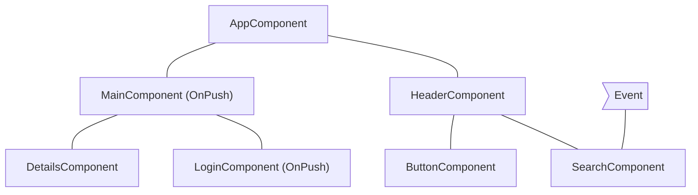
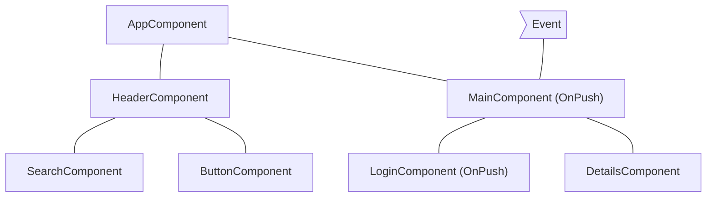
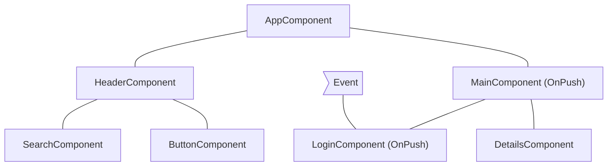
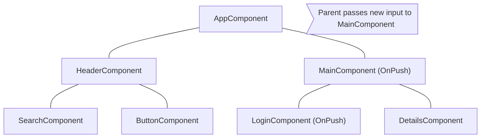

<!-- ia-translate: true -->
# Pulando subárvores de components

Por padrão, o JavaScript usa estruturas de dados mutáveis que você pode referenciar a partir de vários components diferentes. O Angular executa change detection em toda a sua árvore de components para garantir que o estado mais atualizado das suas estruturas de dados seja refletido no DOM.

A change detection é rápida o suficiente para a maioria das aplicações. No entanto, quando uma aplicação tem uma árvore de components especialmente grande, executar change detection em toda a aplicação pode causar problemas de performance. Você pode resolver isso configurando a change detection para rodar apenas em um subconjunto da árvore de components.

## Usando `OnPush` {#using-onpush}

OnPush é a estratégia de change detection padrão no Angular (desde a v22). Ela instrui o Angular a executar change detection para uma subárvore de components **apenas** quando:

- O component raiz da subárvore recebe novos inputs como resultado de um template binding. O Angular compara o valor atual e o valor anterior do input com `Object.is`.
- O Angular trata um evento _(por exemplo, usando event binding, output binding ou `@HostListener`)_ no component raiz da subárvore ou em qualquer um de seus filhos, estejam eles usando change detection OnPush ou não.

## Cenários comuns de change detection {#common-change-detection-scenarios}

Esta seção examina alguns cenários comuns de change detection para ilustrar o comportamento do Angular.

### Um evento é tratado por um component com `Eager` change detection {#an-event-is-handled-by-a-component-with-eager-change-detection}

Se o Angular tratar um evento dentro de um component com a estratégia `Eager`, o framework executa change detection em toda a árvore de components. O Angular pulará as subárvores de components descendentes com raízes usando OnPush que não receberam novos inputs.

Como exemplo, se definirmos a estratégia de change detection do `MainComponent` como OnPush e o usuário interagir com um component fora da subárvore com raiz `MainComponent`, o Angular verificará todos os components rosa do diagrama abaixo (`AppComponent`, `HeaderComponent`, `SearchComponent`, `ButtonComponent`), a menos que o `MainComponent` receba novos inputs:

## Um evento é tratado por um component com OnPush {#an-event-is-handled-by-a-component-with-onpush}

Se o Angular tratar um evento dentro de um component com estratégia OnPush, o framework executará change detection em toda a árvore de components. O Angular ignorará as subárvores de components com raízes usando OnPush que não receberam novos inputs e que estão fora do component que tratou o evento.

Como exemplo, se o Angular tratar um evento dentro do `MainComponent`, o framework executará change detection em toda a árvore de components. O Angular ignorará a subárvore com raiz `LoginComponent`, porque ela tem OnPush e o evento aconteceu fora do seu escopo.

## Um evento é tratado por um descendente de um component com OnPush {#an-event-is-handled-by-a-descendant-of-a-component-with-onpush}

Se o Angular tratar um evento em um component com OnPush, o framework executará change detection em toda a árvore de components, incluindo os ancestrais do component.

Como exemplo, no diagrama abaixo, o Angular trata um evento no `LoginComponent`, que usa OnPush. O Angular invocará change detection em toda a subárvore de components, incluindo o `MainComponent` (pai do `LoginComponent`), mesmo que o `MainComponent` também tenha OnPush. O Angular verifica o `MainComponent` também porque o `LoginComponent` faz parte da sua view.

## Novos inputs para component com OnPush {#new-inputs-to-component-with-onpush}

O Angular executará change detection dentro de um component filho com OnPush ao definir uma propriedade de input como resultado de um template binding.

Por exemplo, no diagrama abaixo, o `AppComponent` passa um novo input para o `MainComponent`, que tem OnPush. O Angular executará change detection no `MainComponent`, mas não executará change detection no `LoginComponent`, que também tem OnPush, a menos que ele também receba novos inputs.

## Casos extremos {#edge-cases}

- **Modificando propriedades de input em código TypeScript**. Quando você usa uma API como `@ViewChild` ou `@ContentChild` para obter uma referência a um component em TypeScript e modifica manualmente uma propriedade `@Input`, o Angular não executará change detection automaticamente para components OnPush. Se você precisar que o Angular execute change detection, pode injetar `ChangeDetectorRef` no seu component e chamar `changeDetectorRef.markForCheck()` para dizer ao Angular que agende uma change detection.
- **Modificando referências de objetos**. Caso um input receba um objeto mutável como valor e você modifique o objeto mas preserve a referência, o Angular não invocará change detection. Esse é o comportamento esperado, porque o valor anterior e o valor atual do input apontam para a mesma referência.
