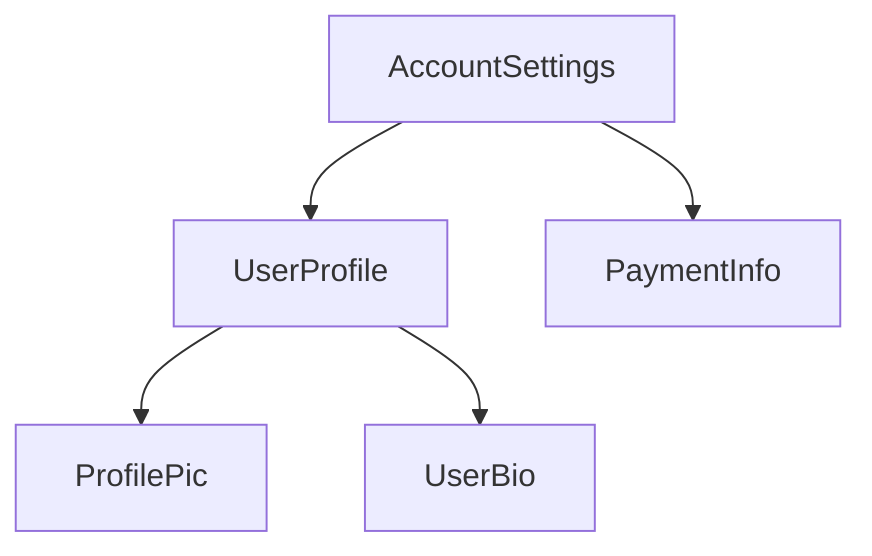

<!-- ia-translate: true -->
<docs-decorative-header title="Anatomia de um component" imgSrc="adev/src/assets/images/components.svg"> <!-- markdownlint-disable-line -->
</docs-decorative-header>

TIP: Este guia pressupõe que você já leu o [Guia de Fundamentos](essentials). Leia-o primeiro se você é novo no Angular.

Todo component deve ter:

- Uma classe TypeScript com _comportamentos_, como tratar a entrada do usuário e buscar dados de um servidor
- Um template HTML que controla o que é renderizado no DOM
- Um [seletor CSS](https://developer.mozilla.org/docs/Learn/CSS/Building_blocks/Selectors) que define como o component é usado no HTML

Você fornece informações específicas do Angular para um component adicionando um [decorator](https://www.typescriptlang.org/docs/handbook/decorators.html) `@Component` no topo da classe TypeScript:

```angular-ts {highlight: [1, 2, 3, 4]}
@Component({
  selector: 'profile-photo',
  template: ``,
})
export class ProfilePhoto {}
```

Para detalhes completos sobre como escrever templates Angular, incluindo data binding, manipulação de eventos e controle de fluxo, consulte o [guia de Templates](guide/templates).

O objeto passado para o decorator `@Component` é chamado de **metadata** do component. Isso inclui o `selector`, o `template` e outras propriedades descritas ao longo deste guia.

Components também podem incluir opcionalmente uma lista de estilos CSS que se aplicam ao DOM desse component:

```angular-ts {highlight: [4]}
@Component({
  selector: 'profile-photo',
  template: ``,
  styles: `
    img {
      border-radius: 50%;
    }
  `,
})
export class ProfilePhoto {}
```

Por padrão, os estilos de um component afetam apenas os elementos definidos no template desse component. Consulte [Estilizando components](guide/components/styling) para detalhes sobre a abordagem do Angular para estilização.

Você também pode optar por escrever o template e os estilos em arquivos separados:

```ts {highlight: [3,4]}
@Component({
  selector: 'profile-photo',
  templateUrl: 'profile-photo.html',
  styleUrl: 'profile-photo.css',
})
export class ProfilePhoto {}
```

Isso pode ajudar a separar as preocupações de _apresentação_ e de _comportamento_ no seu projeto. Você pode escolher uma abordagem para o projeto inteiro ou decidir qual usar para cada component.

Tanto `templateUrl` quanto `styleUrl` são relativos ao diretório em que o component está.

## Usando components {#using-components}

### Imports no decorator `@Component` {#imports-in-the-component-decorator}

Para usar um component, uma [directive](guide/directives) ou um [pipe](guide/templates/pipes), você deve adicioná-lo ao array `imports` do decorator `@Component`:

```ts
import {Component} from '@angular/core';
import {ProfilePhoto} from './profile-photo';

@Component({
  // Importe o component `ProfilePhoto` para
  // poder usá-lo no template deste component.
  imports: [ProfilePhoto],
  /* ... */
})
export class UserProfile {}
```

Por padrão, components Angular são _standalone_, o que significa que você pode adicioná-los diretamente ao array `imports` de outros components. Components criados com uma versão anterior do Angular podem, em vez disso, especificar `standalone: false` no decorator `@Component`. Para esses components, você deve importar o `NgModule` em que o component está definido. Consulte o [guia completo de `NgModule`](guide/ngmodules/overview) para mais detalhes.

IMPORTANT: Nas versões do Angular anteriores à 19.0.0, a opção `standalone` tem como padrão `false`.

### Mostrando components em um template {#showing-components-in-a-template}

Todo component define um [seletor CSS](https://developer.mozilla.org/docs/Learn/CSS/Building_blocks/Selectors):

```angular-ts {highlight: [2]}
@Component({
  selector: 'profile-photo',
  ...
})
export class ProfilePhoto { }
```

Consulte [Seletores de components](guide/components/selectors) para detalhes sobre quais tipos de seletores o Angular suporta e orientações sobre como escolher um seletor.

Você exibe um component criando um elemento HTML correspondente no template de _outros_ components:

```angular-ts {highlight: [8]}
@Component({
  selector: 'profile-photo',
})
export class ProfilePhoto {}

@Component({
  imports: [ProfilePhoto],
  template: `<profile-photo />`,
})
export class UserProfile {}
```

O Angular cria uma instância do component para cada elemento HTML correspondente que encontra. O elemento DOM que corresponde ao seletor de um component é chamado de **elemento host** desse component. O conteúdo do template de um component é renderizado dentro do seu elemento host.

O DOM renderizado por um component, correspondente ao template desse component, é chamado de **view** desse component.

Ao compor components dessa forma, **você pode pensar na sua aplicação Angular como uma árvore de components**.



Essa estrutura em árvore é importante para entender vários outros conceitos do Angular, incluindo [injeção de dependência](guide/di) e [consultas filhas](guide/components/queries).
