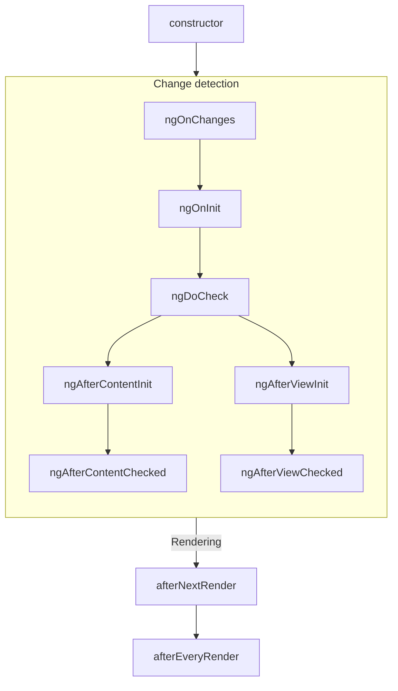
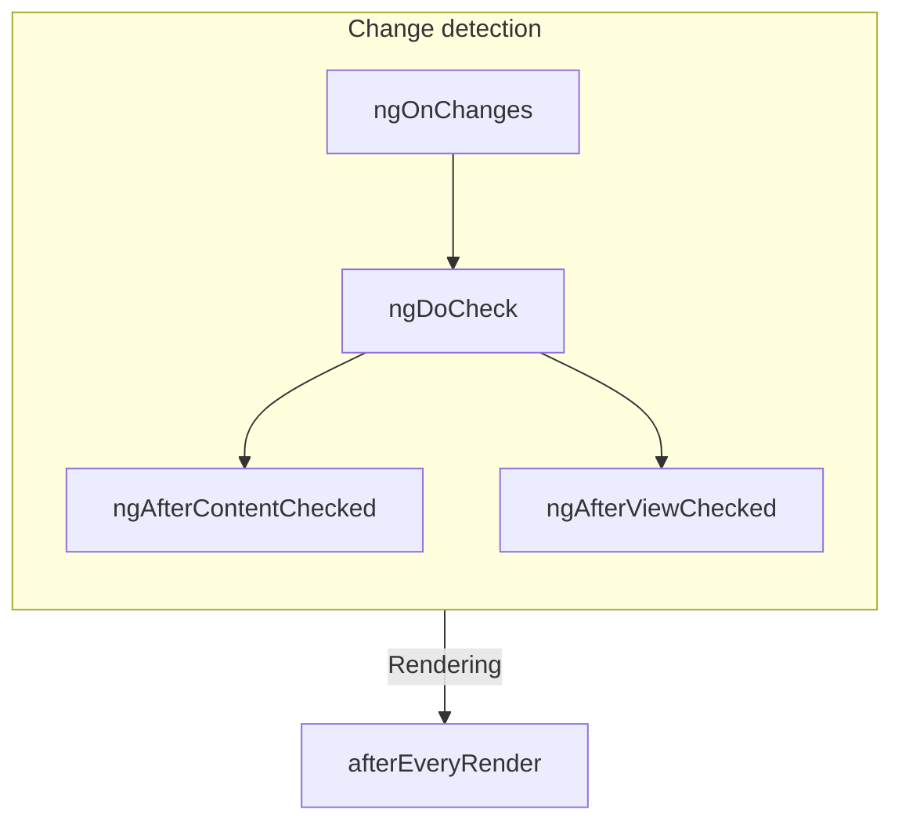

<!-- ia-translate: true -->
# Ciclo de vida de component

TIP: Este guia pressupõe que você já leu o [Guia de Fundamentos](essentials). Leia-o primeiro se você é novo no Angular.

O **ciclo de vida** de um component é a sequência de etapas que acontecem entre a criação do component e a sua destruição. Cada etapa representa uma parte diferente do processo do Angular para renderizar components e verificá-los quanto a atualizações ao longo do tempo.

Em seus components, você pode implementar **hooks de ciclo de vida** para executar código durante essas etapas. Hooks de ciclo de vida relacionados a uma instância específica de component são implementados como métodos na classe do component. Hooks de ciclo de vida relacionados à aplicação Angular como um todo são implementados como funções que aceitam um callback.

O ciclo de vida de um component está intimamente ligado a como o Angular verifica seus components quanto a mudanças ao longo do tempo. Para entender esse ciclo de vida, você só precisa saber que o Angular percorre a árvore da sua aplicação de cima para baixo, verificando os bindings de template quanto a mudanças. Os hooks de ciclo de vida descritos abaixo são executados enquanto o Angular faz essa travessia. Essa travessia visita cada component exatamente uma vez, então você deve sempre evitar fazer novas mudanças de estado no meio do processo.

## Resumo {#summary}

<div class="docs-table docs-scroll-track-transparent">
  <table>
    <tr>
      <td><strong>Fase</strong></td>
      <td><strong>Método</strong></td>
      <td><strong>Resumo</strong></td>
    </tr>
    <tr>
      <td>Criação</td>
      <td><code>constructor</code></td>
      <td>
        <a href="https://developer.mozilla.org/docs/Web/JavaScript/Reference/Classes/constructor" target="_blank">
          Constructor de classe JavaScript padrão
        </a>. Executa quando o Angular instancia o component.
      </td>
    </tr>
    <tr>
      <td rowspan="7">Detecção<br>de Mudanças</td>
      <td><code>ngOnInit</code>
      </td>
      <td>Executa uma vez depois que o Angular inicializa todos os inputs do component.</td>
    </tr>
    <tr>
      <td><code>ngOnChanges</code></td>
      <td>Executa toda vez que os inputs do component mudam.</td>
    </tr>
    <tr>
      <td><code>ngDoCheck</code></td>
      <td>Executa toda vez que este component é verificado quanto a mudanças.</td>
    </tr>
    <tr>
      <td><code>ngAfterContentInit</code></td>
      <td>Executa uma vez depois que o <em>conteúdo</em> do component foi inicializado.</td>
    </tr>
    <tr>
      <td><code>ngAfterContentChecked</code></td>
      <td>Executa toda vez que o conteúdo deste component é verificado quanto a mudanças.</td>
    </tr>
    <tr>
      <td><code>ngAfterViewInit</code></td>
      <td>Executa uma vez depois que a <em>view</em> do component foi inicializada.</td>
    </tr>
    <tr>
      <td><code>ngAfterViewChecked</code></td>
      <td>Executa toda vez que a view do component é verificada quanto a mudanças.</td>
    </tr>
    <tr>
      <td rowspan="2">Renderização</td>
      <td><code>afterNextRender</code></td>
      <td>Executa uma vez, na próxima vez que <strong>todos</strong> os components forem renderizados no DOM.</td>
    </tr>
    <tr>
      <td><code>afterEveryRender</code></td>
      <td>Executa toda vez que <strong>todos</strong> os components forem renderizados no DOM.</td>
    </tr>
    <tr>
      <td>Destruição</td>
      <td><code>ngOnDestroy</code></td>
      <td>Executa uma vez antes que o component seja destruído.</td>
    </tr>
  </table>
</div>

### ngOnInit

O método `ngOnInit` executa depois que o Angular inicializa todos os inputs do component com seus valores iniciais. O `ngOnInit` de um component executa exatamente uma vez.

Essa etapa acontece _antes_ de a view do próprio component ser inicializada. Isso significa que você pode atualizar o estado do component com base nos valores iniciais dos seus inputs.

### ngOnChanges

O método `ngOnChanges` executa depois que qualquer input do component mudou.

Essa etapa acontece _antes_ de o template do próprio component ser verificado. Isso significa que você pode atualizar o estado do component com base nos valores iniciais dos seus inputs.

Durante a inicialização, o primeiro `ngOnChanges` executa antes do `ngOnInit`.

#### Inspecionando mudanças {#inspecting-changes}

O método `ngOnChanges` aceita um argumento `SimpleChanges`. Esse objeto é um [`Record`](https://www.typescriptlang.org/docs/handbook/utility-types.html#recordkeys-type) que mapeia o nome de cada input do component para um objeto `SimpleChange`. Cada `SimpleChange` contém o valor anterior do input, seu valor atual e uma flag indicando se esta é a primeira vez que o input mudou.

Você pode, opcionalmente, passar a classe atual ou `this` como primeiro argumento genérico para uma verificação de tipos mais forte.

```ts
@Component({/* ... */})
export class UserProfile {
  name = input('');

  ngOnChanges(changes: SimpleChanges<UserProfile>) {
    if (changes.name) {
      console.log(`Anterior: ${changes.name.previousValue}`);
      console.log(`Atual: ${changes.name.currentValue}`);
      console.log(`É a primeira vez: ${changes.name.firstChange}`);
    }
  }
}
```

Se você fornecer um `alias` para quaisquer propriedades de input, o Record `SimpleChanges` ainda usa o nome da propriedade TypeScript como chave, em vez do alias.

### ngOnDestroy

O método `ngOnDestroy` executa uma vez, logo antes de um component ser destruído. O Angular destrói um component quando ele não é mais exibido na página, como quando é ocultado por `@if` ou ao navegar para outra página.

#### DestroyRef

Como alternativa ao método `ngOnDestroy`, você pode injetar uma instância de `DestroyRef`. Você pode registrar um callback para ser invocado na destruição do component chamando o método `onDestroy` de `DestroyRef`.

```ts
@Component({/* ... */})
export class UserProfile {
  constructor() {
    inject(DestroyRef).onDestroy(() => {
      console.log('Destruição de UserProfile');
    });
  }
}
```

Você pode passar a instância de `DestroyRef` para funções ou classes fora do seu component. Use esse padrão se você tiver outro código que deve executar alguma limpeza quando o component for destruído.

Você também pode usar `DestroyRef` para manter o código de configuração próximo ao código de limpeza, em vez de colocar todo o código de limpeza no método `ngOnDestroy`.

##### Detectando destruição de instância {#detecting-instance-destruction}

`DestroyRef` fornece uma propriedade `destroyed` que permite verificar se uma determinada instância já foi destruída. Isso é útil para evitar operações em components destruídos, especialmente ao lidar com lógica atrasada ou assíncrona.

Ao verificar `destroyRef.destroyed`, você evita executar código depois que a instância foi limpa, prevenindo erros potenciais como `NG0911: View has already been destroyed.`.

### ngDoCheck

O método `ngDoCheck` executa antes de toda vez que o Angular verifica o template de um component quanto a mudanças.

Você pode usar este hook de ciclo de vida para verificar manualmente mudanças de estado fora da detecção de mudanças normal do Angular, atualizando o estado do component manualmente.

Este método executa com muita frequência e pode impactar significativamente o desempenho da sua página. Evite definir este hook sempre que possível, usando-o somente quando não houver alternativa.

Durante a inicialização, o primeiro `ngDoCheck` executa depois do `ngOnInit`.

### ngAfterContentInit

O método `ngAfterContentInit` executa uma vez depois que todos os filhos aninhados dentro do component (seu _conteúdo_) foram inicializados.

Você pode usar este hook de ciclo de vida para ler os resultados de [consultas de conteúdo](guide/components/queries#content-queries). Embora você possa acessar o estado inicializado dessas consultas, evite alterar estado que não seja signal e que o template de um ancestral já tenha renderizado. Isso pode resultar em um [ExpressionChangedAfterItHasBeenCheckedError](errors/NG0100).

### ngAfterContentChecked

O método `ngAfterContentChecked` executa toda vez que os filhos aninhados dentro do component (seu _conteúdo_) são verificados quanto a mudanças.

Este método executa com muita frequência e pode impactar significativamente o desempenho da sua página. Evite definir este hook sempre que possível, usando-o somente quando não houver alternativa.

Embora você possa acessar o estado atualizado de [consultas de conteúdo](guide/components/queries#content-queries) aqui, evite alterar estado que não seja signal e que o template de um ancestral já tenha renderizado. Isso pode resultar em um [ExpressionChangedAfterItHasBeenCheckedError](errors/NG0100).

### ngAfterViewInit

O método `ngAfterViewInit` executa uma vez depois que todos os filhos no template do component (sua _view_) foram inicializados.

Você pode usar este hook de ciclo de vida para ler os resultados de [consultas de view](guide/components/queries#view-queries). Embora você possa acessar o estado inicializado dessas consultas, evite alterar estado que não seja signal e que o template já tenha renderizado. Isso pode resultar em um [ExpressionChangedAfterItHasBeenCheckedError](errors/NG0100).

### ngAfterViewChecked

O método `ngAfterViewChecked` executa toda vez que os filhos no template do component (sua _view_) são verificados quanto a mudanças.

Este método executa com muita frequência e pode impactar significativamente o desempenho da sua página. Evite definir este hook sempre que possível, usando-o somente quando não houver alternativa.

Embora você possa acessar o estado atualizado de [consultas de view](guide/components/queries#view-queries) aqui, evite alterar estado que não seja signal e que o template já tenha renderizado. Isso pode resultar em um [ExpressionChangedAfterItHasBeenCheckedError](errors/NG0100).

### afterEveryRender e afterNextRender {#aftereveryrender-and-afternextrender}

As funções `afterEveryRender` e `afterNextRender` permitem registrar um **render callback** (callback de renderização) para ser invocado depois que o Angular terminar de renderizar _todos os components_ da página no DOM.

Essas funções são diferentes dos outros hooks de ciclo de vida descritos neste guia. Em vez de um método de classe, são funções independentes que aceitam um callback. A execução dos render callbacks não está vinculada a nenhuma instância de component específica, mas sim a um hook de toda a aplicação.

`afterEveryRender` e `afterNextRender` devem ser chamados em um [contexto de injeção](guide/di/dependency-injection-context), normalmente no constructor de um component.

Você pode usar render callbacks para realizar operações manuais no DOM. Consulte [Usando APIs DOM](guide/components/dom-apis) para orientações sobre como trabalhar com o DOM no Angular.

Render callbacks não são executados durante a renderização no servidor ou a pré-renderização em tempo de build.

#### Fases after\*Render {#afterrender-phases}

Ao usar `afterEveryRender` ou `afterNextRender`, você pode, opcionalmente, dividir o trabalho em fases. A fase dá controle sobre o sequenciamento das operações no DOM, permitindo ordenar operações de _escrita_ antes de operações de _leitura_ para minimizar o [layout thrashing](https://web.dev/avoid-large-complex-layouts-and-layout-thrashing). Para se comunicar entre fases, uma função de fase pode retornar um valor de resultado que pode ser acessado na fase seguinte.

```ts
import {Component, ElementRef, afterNextRender, inject} from '@angular/core';

@Component({/* ... */})
export class UserProfile {
  private prevPadding = 0;
  private elementHeight = 0;

  constructor() {
    const elementRef = inject(ElementRef);
    const nativeElement = elementRef.nativeElement;

    afterNextRender({
      // Use a fase `Write` para escrever em uma propriedade geométrica.
      write: () => {
        const padding = computePadding();
        const changed = padding !== this.prevPadding;
        if (changed) {
          nativeElement.style.padding = padding;
        }
        return changed; // Comunica à fase de leitura se algo mudou.
      },

      // Use a fase `Read` para ler propriedades geométricas depois que todas as escritas ocorreram.
      read: (didWrite) => {
        if (didWrite) {
          this.elementHeight = nativeElement.getBoundingClientRect().height;
        }
      },
    });
  }
}
```

Existem quatro fases, executadas na seguinte ordem:

| Fase             | Descrição                                                                                                                                                                                                                  |
| ---------------- | -------------------------------------------------------------------------------------------------------------------------------------------------------------------------------------------------------------------------- |
| `earlyRead`      | Use esta fase para ler quaisquer propriedades e estilos do DOM que afetam o layout e que são estritamente necessários para cálculos subsequentes. Evite esta fase se possível, preferindo as fases `write` e `read`.       |
| `mixedReadWrite` | Fase padrão. Use para quaisquer operações que precisem ler e escrever propriedades e estilos que afetam o layout. Evite esta fase se possível, preferindo as fases explícitas `write` e `read`.                            |
| `write`          | Use esta fase para escrever propriedades e estilos do DOM que afetam o layout.                                                                                                                                              |
| `read`           | Use esta fase para ler quaisquer propriedades do DOM que afetam o layout.                                                                                                                                                  |

## Interfaces de ciclo de vida {#lifecycle-interfaces}

O Angular fornece uma interface TypeScript para cada método de ciclo de vida. Você pode, opcionalmente, importar e `implementar` essas interfaces para garantir que sua implementação não tenha erros de digitação.

Cada interface tem o mesmo nome do método correspondente, sem o prefixo `ng`. Por exemplo, a interface para `ngOnInit` é `OnInit`.

```ts
@Component({/* ... */})
export class UserProfile implements OnInit {
  ngOnInit() {
    /* ... */
  }
}
```

## Ordem de execução {#execution-order}

Os diagramas a seguir mostram a ordem de execução dos hooks de ciclo de vida do Angular.

### Durante a inicialização {#during-initialization}



### Atualizações subsequentes {#subsequent-updates}



### Ordenação com directives {#ordering-with-directives}

Quando você coloca uma ou mais directives no mesmo elemento de um component, seja em um template ou com a propriedade `hostDirectives`, o framework não garante nenhuma ordenação de um determinado hook de ciclo de vida entre o component e as directives em um único elemento. Nunca dependa de uma ordem observada, pois ela pode mudar em versões futuras do Angular.
