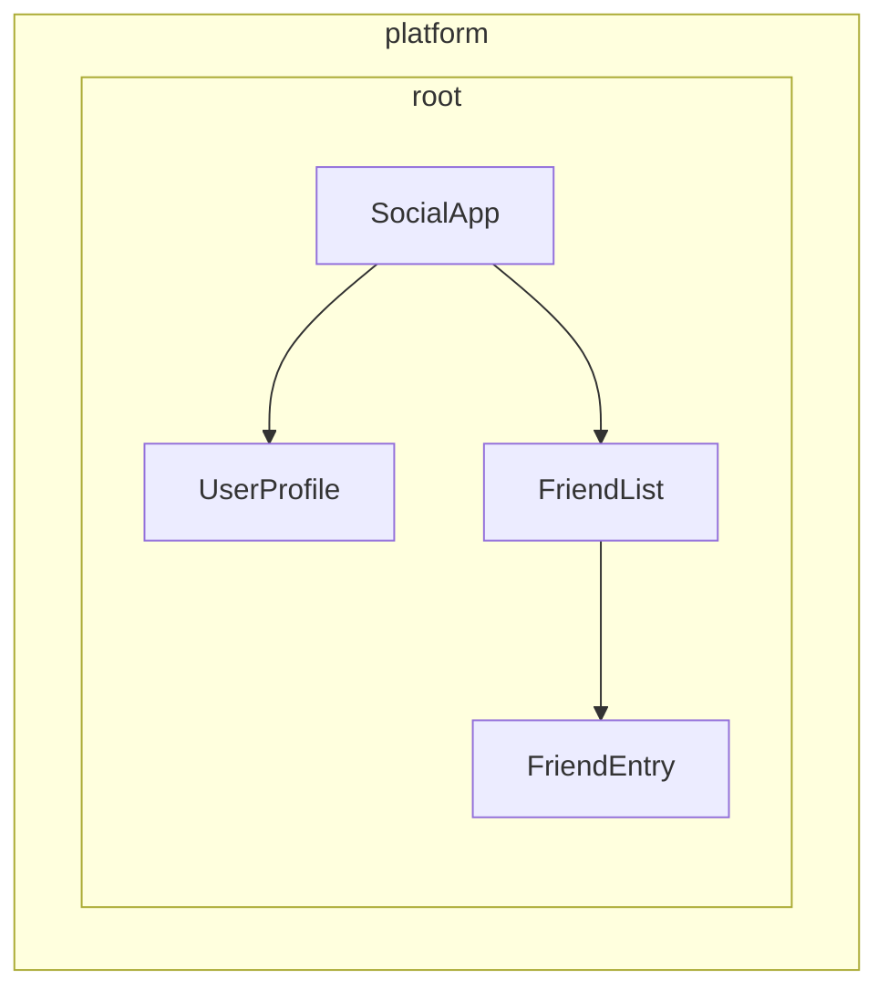

<!-- ia-translate: true -->

# Definindo providers de dependência

O Angular oferece duas formas de tornar services disponíveis para injeção:

1. **Provisão automática** - Usando `providedIn` no decorator `@Injectable`, o decorator [`@Service`](guide/di/creating-and-using-services#using-the-service-vs-injectable-decorator), ou fornecendo uma factory na configuração do `InjectionToken`
2. **Provisão manual** - Usando o array `providers` em components, directives, routes ou na configuração da aplicação

No [guia anterior](/guide/di/creating-and-using-services), você aprendeu a criar services usando `providedIn: 'root'`, que cobre a maioria dos casos de uso comuns. Este guia explora padrões adicionais para a configuração de providers, tanto automática quanto manual.

## Provisão automática para dependências que não são classes {#automatic-provision-for-non-class-dependencies}

Embora o decorator `@Injectable` com `providedIn: 'root'` funcione muito bem para services (classes), você pode precisar fornecer outros tipos de valores globalmente, como objetos de configuração, funções ou valores primitivos. O Angular oferece o `InjectionToken` para essa finalidade.

### O que é um InjectionToken? {#what-is-an-injectiontoken}

Um `InjectionToken` é um objeto que o sistema de injeção de dependência do Angular usa para identificar de forma única os valores injetáveis. Pense nele como uma chave especial que permite armazenar e recuperar qualquer tipo de valor no sistema de DI do Angular:

```ts
import {InjectionToken} from '@angular/core';

// Cria um token para um valor string
export const API_URL = new InjectionToken<string>('api.url');

// Cria um token para uma função
export const LOGGER = new InjectionToken<(msg: string) => void>('logger.function');

// Cria um token para um tipo complexo
export interface Config {
  apiUrl: string;
  timeout: number;
}
export const CONFIG_TOKEN = new InjectionToken<Config>('app.config');
```

NOTE: A string de parâmetro (por exemplo, `'api.url'`) é apenas uma descrição para depuração. O Angular identifica os tokens pela referência do objeto, não por essa string.

### InjectionToken com `providedIn: 'root'` {#injectiontoken-with-providedin-root}

Um `InjectionToken` que tem uma `factory` resulta em `providedIn: 'root'` por padrão (mas isso pode ser sobrescrito pela propriedade `providedIn`).

```ts {header: "/app/config.token.ts"}
import {InjectionToken, Component, inject} from '@angular/core';

export interface AppConfig {
  apiUrl: string;
  version: string;
  features: Record<string, boolean>;
}

// Configuração disponível globalmente usando providedIn
export const APP_CONFIG = new InjectionToken<AppConfig>('app.config', {
  providedIn: 'root',
  factory: () => ({
    apiUrl: 'https://api.example.com',
    version: '1.0.0',
    features: {
      darkMode: true,
      analytics: false,
    },
  }),
});

// Não é preciso adicionar ao array providers - disponível em qualquer lugar!
@Component({
  selector: 'app-header',
  template: `<h1>Version: {{ config.version }}</h1>`,
})
export class Header {
  config = inject(APP_CONFIG); // Disponível automaticamente
}
```

### Quando usar InjectionToken com funções factory {#when-to-use-injectiontoken-with-factory-functions}

O InjectionToken com funções factory é ideal quando você não pode usar uma classe, mas precisa fornecer dependências globalmente:

```ts {header: "/app/logger.token.ts"}
import {InjectionToken, inject} from '@angular/core';
import {APP_CONFIG} from './config.token';

// Tipo da função de logger
export type LoggerFn = (level: string, message: string) => void;

// Função de logger global com dependências
export const LOGGER_FN = new InjectionToken<LoggerFn>('logger.function', {
  providedIn: 'root',
  factory: () => {
    const config = inject(APP_CONFIG);

    return (level: string, message: string) => {
      if (config.features.logging !== false) {
        console[level](`[${new Date().toISOString()}] ${message}`);
      }
    };
  },
});
```

```ts {header: "/app/storage.token.ts"}
// Fornecendo APIs do navegador como tokens
export const LOCAL_STORAGE = new InjectionToken<Storage>('localStorage', {
  // providedIn: 'root' já é configurado como padrão
  factory: () => window.localStorage,
});

export const SESSION_STORAGE = new InjectionToken<Storage>('sessionStorage', {
  providedIn: 'root',
  factory: () => window.sessionStorage,
});
```

```ts {header: "/app/feature-flags.token.ts"}
// Configuração complexa com lógica de runtime
export const FEATURE_FLAGS = new InjectionToken<Map<string, boolean>>('feature.flags', {
  providedIn: 'root',
  factory: () => {
    const flags = new Map<string, boolean>();

    // Lê do ambiente ou dos parâmetros da URL
    const urlParams = new URLSearchParams(window.location.search);
    const enableBeta = urlParams.get('beta') === 'true';

    flags.set('betaFeatures', enableBeta);
    flags.set('darkMode', true);
    flags.set('newDashboard', false);

    return flags;
  },
});
```

Essa abordagem oferece várias vantagens:

- **Nenhuma configuração manual de provider necessária** - Funciona como o `providedIn: 'root'` para services
- **Tree-shakeable** - Só é incluído se realmente for usado
- **Type-safe** - Suporte completo do TypeScript para valores que não são classes
- **Pode injetar outras dependências** - Funções factory podem usar `inject()` para acessar outros services

## Entendendo a configuração manual de providers {#understanding-manual-provider-configuration}

Quando você precisa de mais controle do que o `providedIn: 'root'` oferece, pode configurar os providers manualmente. A configuração manual pelo array `providers` é útil quando:

1. **O service não tem `providedIn`** - Services sem provisão automática precisam ser fornecidos manualmente
2. **Você quer uma nova instância** - Para criar uma instância separada no nível do component/directive, em vez de usar a compartilhada
3. **Você precisa de configuração em runtime** - Quando o comportamento do service depende de valores de runtime
4. **Você está fornecendo valores que não são classes** - Objetos de configuração, funções ou valores primitivos

### Exemplo: service sem `providedIn` {#example-service-without-providedin}

```ts
import {Injectable, Component, inject} from '@angular/core';

// Service sem providedIn
@Injectable()
export class LocalDataStore {
  private data: string[] = [];

  addData(item: string) {
    this.data.push(item);
  }
}

// O component precisa fornecê-lo
@Component({
  selector: 'app-example',
  // Um provider é necessário aqui porque o service `LocalDataStore` não tem providedIn.
  providers: [LocalDataStore],
  template: `...`,
})
export class Example {
  dataStore = inject(LocalDataStore);
}
```

### Exemplo: criando instâncias específicas de component {#example-creating-component-specific-instances}

Services com `providedIn: 'root'` podem ser sobrescritos no nível do component. Isso vincula a instância do service ao ciclo de vida do component. Como resultado, quando o component é destruído, o service fornecido também é destruído.

```ts
import {Injectable, Component, inject} from '@angular/core';

@Injectable({providedIn: 'root'})
export class DataStore {
  private data: ListItem[] = [];
}

// Este component recebe sua própria instância
@Component({
  selector: 'app-isolated',
  // Cria uma nova instância de `DataStore` em vez de usar a instância fornecida na raiz.
  providers: [DataStore],
  template: `...`,
})
export class Isolated {
  dataStore = inject(DataStore); // Instância específica do component
}
```

## Hierarquia de injectors no Angular {#injector-hierarchy-in-angular}

O sistema de injeção de dependência do Angular é hierárquico. Quando um component solicita uma dependência, o Angular começa pelo injector desse component e sobe pela árvore até encontrar um provider para aquela dependência. Cada component na árvore da aplicação pode ter seu próprio injector, e esses injectors formam uma hierarquia que espelha a árvore de components.

Essa hierarquia permite:

- **Instâncias com escopo**: Diferentes partes da aplicação podem ter diferentes instâncias do mesmo service
- **Sobrescrever comportamento**: Components filhos podem sobrescrever providers dos components pais
- **Eficiência de memória**: Services são instanciados somente onde são necessários

No Angular, qualquer elemento com um component ou directive pode fornecer valores para todos os seus descendentes.



No exemplo acima:

1. `SocialApp` pode fornecer valores para `UserProfile` e `FriendList`
2. `FriendList` pode fornecer valores para injeção em `FriendEntry`, mas não pode fornecer valores para injeção em `UserProfile`, porque não faz parte da árvore

## Declarando um provider {#declaring-a-provider}

Pense no sistema de injeção de dependência do Angular como um hash map ou dicionário. Cada objeto de configuração de provider define um par chave-valor:

- **Chave (identificador do provider)**: O identificador único que você usa para solicitar uma dependência
- **Valor**: O que o Angular deve retornar quando aquele token for solicitado

Ao fornecer dependências manualmente, você normalmente verá esta sintaxe abreviada:

```angular-ts
import {Component} from '@angular/core';
import {LocalService} from './local-service';

@Component({
  selector: 'app-example',
  providers: [LocalService], // Service sem providedIn
})
export class Example {}
```

Essa é, na verdade, uma forma abreviada de uma configuração de provider mais detalhada:

```ts
{
  // Esta é a versão abreviada
  providers: [LocalService],

  // Esta é a versão completa
  providers: [
    { provide: LocalService, useClass: LocalService }
  ]
}
```

### Objeto de configuração do provider {#provider-configuration-object}

Todo objeto de configuração de provider tem duas partes principais:

1. **Identificador do provider**: A chave única que o Angular usa para obter a dependência (definida pela propriedade `provide`)
2. **Valor**: A dependência real que você quer que o Angular busque, configurada com chaves diferentes conforme o tipo desejado:
   - `useClass` - Fornece uma classe JavaScript
   - `useValue` - Fornece um valor estático
   - `useFactory` - Fornece uma função factory que retorna o valor
   - `useExisting` - Fornece um alias para um provider existente

### Identificadores de provider {#provider-identifiers}

Os identificadores de provider permitem que o sistema de injeção de dependência (DI) do Angular recupere uma dependência por meio de um ID único. Você pode gerar identificadores de provider de duas formas:

1. [Nomes de classe](#class-names)
2. [Tokens de injeção](#injection-tokens)

#### Nomes de classe {#class-names}

Nomes de classe usam a própria classe importada como identificador:

```angular-ts
import {Component} from '@angular/core';
import {LocalService} from './local-service';

@Component({
  selector: 'app-example',
  providers: [{provide: LocalService, useClass: LocalService}],
})
export class Example {
  /* ... */
}
```

A classe serve tanto como identificador quanto como implementação, e é por isso que o Angular oferece a forma abreviada `providers: [LocalService]`.

#### Tokens de injeção {#injection-tokens}

O Angular oferece a classe [`InjectionToken`](api/core/InjectionToken) integrada, que cria uma referência de objeto única para valores injetáveis ou quando você quer fornecer múltiplas implementações da mesma interface.

```ts {header: "/app/tokens.ts"}
import {InjectionToken} from '@angular/core';
import {DataService} from './data-service.interface';

export const DATA_SERVICE_TOKEN = new InjectionToken<DataService>('DataService');
```

NOTE: A string `'DataService'` é uma descrição usada apenas para fins de depuração. O Angular identifica o token pela referência do objeto, não por essa string.

Use o token na sua configuração de provider:

```angular-ts
import {Component, inject} from '@angular/core';
import {LocalDataService} from './local-data-service';
import {DATA_SERVICE_TOKEN} from './tokens';

@Component({
  selector: 'app-example',
  providers: [{provide: DATA_SERVICE_TOKEN, useClass: LocalDataService}],
})
export class Example {
  private dataService = inject(DATA_SERVICE_TOKEN);
}
```

#### Interfaces TypeScript podem ser identificadores para injeção? {#can-typescript-interfaces-be-identifiers-for-injection}

Interfaces TypeScript não podem ser usadas para injeção, porque elas não existem em runtime:

```ts
// ❌ Isso não funciona!
interface DataService {
  getData(): string[];
}

// Interfaces desaparecem após a compilação do TypeScript
@Component({
  providers: [
    {provide: DataService, useClass: LocalDataService}, // Erro!
  ],
})
export class Example {
  private dataService = inject(DataService); // Erro!
}

// ✅ Use InjectionToken no lugar
export const DATA_SERVICE_TOKEN = new InjectionToken<DataService>('DataService');

@Component({
  providers: [{provide: DATA_SERVICE_TOKEN, useClass: LocalDataService}],
})
export class Example {
  private dataService = inject(DATA_SERVICE_TOKEN); // Funciona!
}
```

O InjectionToken fornece um valor de runtime que o sistema de DI do Angular pode usar, ao mesmo tempo em que mantém a segurança de tipos pelo parâmetro genérico do TypeScript.

### Tipos de valor do provider {#provider-value-types}

#### useClass

`useClass` fornece uma classe JavaScript como dependência. É o padrão ao usar a sintaxe abreviada:

```ts
// Abreviada
providers: [DataService];

// Sintaxe completa
providers: [{provide: DataService, useClass: DataService}];

// Implementação diferente
providers: [{provide: DataService, useClass: MockDataService}];

// Implementação condicional
providers: [
  {
    provide: StorageService,
    useClass: environment.production ? CloudStorageService : LocalStorageService,
  },
];
```

#### Exemplo prático: substituição de Logger {#practical-example-logger-substitution}

Você pode substituir implementações para estender funcionalidades:

```ts
import {Injectable, Component, inject} from '@angular/core';

// Logger base
@Injectable()
export class Logger {
  log(message: string) {
    console.log(message);
  }
}

// Logger aprimorado com timestamp
@Injectable()
export class BetterLogger extends Logger {
  override log(message: string) {
    super.log(`[${new Date().toISOString()}] ${message}`);
  }
}

// Logger que inclui o contexto do usuário
@Injectable()
export class EvenBetterLogger extends Logger {
  private userService = inject(UserService);

  override log(message: string) {
    const name = this.userService.user.name;
    super.log(`Message to ${name}: ${message}`);
  }
}

// No seu component
@Component({
  selector: 'app-example',
  providers: [
    UserService, // EvenBetterLogger precisa disso
    {provide: Logger, useClass: EvenBetterLogger},
  ],
})
export class Example {
  private logger = inject(Logger); // Recebe a instância de EvenBetterLogger
}
```

#### useValue {#usevalue}

`useValue` fornece qualquer tipo de dado JavaScript como um valor estático:

```ts
providers: [
  {provide: API_URL_TOKEN, useValue: 'https://api.example.com'},
  {provide: MAX_RETRIES_TOKEN, useValue: 3},
  {provide: FEATURE_FLAGS_TOKEN, useValue: {darkMode: true, beta: false}},
];
```

IMPORTANT: Tipos e interfaces TypeScript não podem servir como valores de dependência. Eles existem apenas em tempo de compilação.

#### Exemplo prático: configuração da aplicação {#practical-example-application-configuration}

Um caso de uso comum para `useValue` é fornecer a configuração da aplicação:

```ts
// Define a interface de configuração
export interface AppConfig {
  apiUrl: string;
  appTitle: string;
  features: {
    darkMode: boolean;
    analytics: boolean;
  };
}

// Cria o token de injeção
export const APP_CONFIG = new InjectionToken<AppConfig>('app.config');

// Define a configuração
const appConfig: AppConfig = {
  apiUrl: 'https://api.example.com',
  appTitle: 'My Application',
  features: {
    darkMode: true,
    analytics: false,
  },
};

// Fornece no bootstrap
bootstrapApplication(AppComponent, {
  providers: [{provide: APP_CONFIG, useValue: appConfig}],
});

// Usa no component
@Component({
  selector: 'app-header',
  template: `<h1>{{ title }}</h1>`,
})
export class Header {
  private config = inject(APP_CONFIG);
  title = this.config.appTitle;
}
```

#### useFactory {#usefactory}

`useFactory` fornece uma função que gera um novo valor para injeção:

```ts
export const loggerFactory = (config: AppConfig) => {
  return new LoggerService(config.logLevel, config.endpoint);
};

providers: [
  {
    provide: LoggerService,
    useFactory: loggerFactory,
    deps: [APP_CONFIG], // Dependências da função factory
  },
];
```

Você pode marcar as dependências da factory como opcionais:

```ts
import {Optional} from '@angular/core';

providers: [
  {
    provide: MyService,
    useFactory: (required: RequiredService, optional?: OptionalService) => {
      return new MyService(required, optional || new DefaultService());
    },
    deps: [RequiredService, [new Optional(), OptionalService]],
  },
];
```

#### Exemplo prático: cliente de API baseado em configuração {#practical-example-configuration-based-api-client}

Aqui está um exemplo completo mostrando como usar uma factory para criar um service com configuração de runtime:

```ts
// Service que precisa de configuração de runtime
class ApiClient {
  constructor(
    private http: HttpClient,
    private baseUrl: string,
    private rateLimitMs: number,
  ) {}

  async fetchData(endpoint: string) {
    // Aplica limitação de taxa com base no plano do usuário
    await this.applyRateLimit();
    return this.http.get(`${this.baseUrl}/${endpoint}`);
  }

  private async applyRateLimit() {
    // Exemplo simplificado - a implementação real acompanharia o tempo das requisições
    return new Promise((resolve) => setTimeout(resolve, this.rateLimitMs));
  }
}

// Função factory que configura com base no plano do usuário
import {inject, Component} from '@angular/core';
import {HttpClient} from '@angular/common/http';
const apiClientFactory = () => {
  const http = inject(HttpClient);
  const userService = inject(UserService);

  // Assumindo que o userService fornece esses valores
  const baseUrl = userService.getApiBaseUrl();
  const rateLimitMs = userService.getRateLimit();

  return new ApiClient(http, baseUrl, rateLimitMs);
};

// Configuração do provider
export const apiClientProvider = {
  provide: ApiClient,
  useFactory: apiClientFactory,
};

// Uso no component
@Component({
  selector: 'app-dashboard',
  providers: [apiClientProvider],
})
export class Dashboard {
  private apiClient = inject(ApiClient);
}
```

#### useExisting

`useExisting` cria um alias para um provider que já foi definido. Os dois tokens retornam a mesma instância:

```ts
providers: [
  NewLogger, // O service em si
  {provide: OldLogger, useExisting: NewLogger}, // O alias
];
```

IMPORTANT: Não confunda `useExisting` com `useClass`. O `useClass` cria instâncias separadas, enquanto o `useExisting` garante que você obtenha a mesma instância singleton.

### Múltiplos providers {#multiple-providers}

Use a flag `multi: true` quando múltiplos providers contribuem com valores para o mesmo token:

```ts
export const INTERCEPTOR_TOKEN = new InjectionToken<Interceptor[]>('interceptors');

providers: [
  {provide: INTERCEPTOR_TOKEN, useClass: AuthInterceptor, multi: true},
  {provide: INTERCEPTOR_TOKEN, useClass: LoggingInterceptor, multi: true},
  {provide: INTERCEPTOR_TOKEN, useClass: RetryInterceptor, multi: true},
];
```

Quando você injeta `INTERCEPTOR_TOKEN`, recebe um array contendo instâncias dos três interceptors.

## Onde você pode especificar providers? {#where-can-you-specify-providers}

O Angular oferece vários níveis em que você pode registrar providers, cada um com implicações diferentes de escopo, ciclo de vida e desempenho:

- [**Bootstrap da aplicação**](#application-bootstrap) - Singletons globais disponíveis em qualquer lugar
- [**Em um elemento (component ou directive)**](#component-or-directive-providers) - Instâncias isoladas para árvores de components específicas
- [**Route**](#route-providers) - Services específicos de uma feature para módulos lazy-loaded

### Bootstrap da aplicação {#application-bootstrap}

Use providers no nível da aplicação, em `bootstrapApplication`, quando:

- **O service é usado em várias áreas da feature** - Services como clientes HTTP, logging ou autenticação que muitas partes da aplicação precisam
- **Você quer um singleton verdadeiro** - Uma única instância compartilhada por toda a aplicação
- **O service não tem configuração específica de component** - Utilitários de propósito geral que funcionam da mesma forma em qualquer lugar
- **Você está fornecendo configuração global** - Endpoints de API, feature flags ou configurações de ambiente

```ts {header: "main.ts"}
bootstrapApplication(App, {
  providers: [
    {provide: API_BASE_URL, useValue: 'https://api.example.com'},
    {provide: INTERCEPTOR_TOKEN, useClass: AuthInterceptor, multi: true},
    LoggingService, // Usado em toda a aplicação
    {provide: ErrorHandler, useClass: GlobalErrorHandler},
  ],
});
```

**Benefícios:**

- Uma única instância reduz o uso de memória
- Disponível em qualquer lugar sem configuração adicional
- Mais fácil de gerenciar o estado global

**Desvantagens:**

- Sempre incluído no bundle JavaScript, mesmo se o valor nunca for injetado
- Não pode ser facilmente customizado por feature
- Mais difícil de testar components isoladamente

#### Por que fornecer durante o bootstrap em vez de usar `providedIn: 'root'`? {#why-provide-during-bootstrap-instead-of-using-providedin-root}

Você pode querer um provider durante o bootstrap quando:

- O provider tem efeitos colaterais (por exemplo, instalar o router do lado do cliente)
- O provider requer configuração (por exemplo, routes)
- Você está usando o padrão `provideSomething` do Angular (por exemplo, `provideRouter`, `provideHttpClient`)

### Providers de component ou directive {#component-or-directive-providers}

Use providers de component ou directive quando:

- **O service tem estado específico do component** - Validadores de formulário, caches específicos de component ou gerenciadores de estado de UI
- **Você precisa de instâncias isoladas** - Cada component precisa da sua própria cópia do service
- **O service é usado por apenas uma árvore de components** - Services especializados que não precisam de acesso global
- **Você está criando components reutilizáveis** - Components que devem funcionar de forma independente, com os próprios services

```angular-ts
// Component de formulário especializado com seu próprio service de validação
@Component({
  selector: 'app-advanced-form',
  providers: [
    FormValidationService, // Cada formulário tem seu próprio validador
    {provide: FORM_CONFIG, useValue: {strictMode: true}},
  ],
})
export class AdvancedForm {}

// Component de modal com gerenciamento de estado isolado
@Component({
  selector: 'app-modal',
  providers: [
    ModalStateService, // Cada modal gerencia o próprio estado
  ],
})
export class Modal {}
```

**Benefícios:**

- Melhor encapsulamento e isolamento
- Mais fácil de testar components individualmente
- Múltiplas instâncias podem coexistir com configurações diferentes

**Desvantagens:**

- Uma nova instância é criada para cada component (maior uso de memória)
- Nenhum estado compartilhado entre components
- Precisa ser fornecido onde for necessário
- Sempre incluído no mesmo bundle JavaScript do component ou directive, mesmo se o valor nunca for injetado

NOTE: Se várias directives no mesmo elemento fornecerem o mesmo token, uma delas vai prevalecer, mas não se sabe qual.

### Providers de route {#route-providers}

Use providers no nível de route para:

- **Services específicos de uma feature** - Services necessários apenas para routes particulares ou módulos de feature
- **Dependências de módulos lazy-loaded** - Services que devem ser carregados apenas com features específicas
- **Configuração específica de route** - Configurações que variam por área da aplicação

```ts {header: "routes.ts"}
export const routes: Routes = [
  {
    path: 'admin',
    providers: [
      AdminService, // Carregado apenas com as routes de admin
      {provide: FEATURE_FLAGS, useValue: {adminMode: true}},
    ],
    loadChildren: () => import('./admin/admin.routes'),
  },
  {
    path: 'shop',
    providers: [
      ShoppingCartService, // Estado isolado do carrinho
      PaymentService,
    ],
    loadChildren: () => import('./shop/shop.routes'),
  },
];
```

Services fornecidos no nível de route ficam disponíveis para todos os components e directives dessa route, assim como para os seus guards e resolvers.

Como esses services são instanciados de forma independente dos components da route, eles não têm acesso direto às informações específicas da route.

## Padrões para autores de bibliotecas {#library-author-patterns}

Ao criar bibliotecas Angular, você frequentemente precisa oferecer opções de configuração flexíveis para os consumidores, mantendo APIs limpas. As próprias bibliotecas do Angular demonstram padrões poderosos para isso.

### O padrão `provide` {#the-provide-pattern}

Em vez de exigir que os usuários configurem manualmente providers complexos, os autores de bibliotecas podem exportar funções que retornam configurações de provider:

```ts {header: "/libs/analytics/src/providers.ts"}
import {InjectionToken, Provider, inject} from '@angular/core';

// Interface de configuração
export interface AnalyticsConfig {
  trackingId: string;
  enableDebugMode?: boolean;
  anonymizeIp?: boolean;
}

// Token interno para a configuração
const ANALYTICS_CONFIG = new InjectionToken<AnalyticsConfig>('analytics.config');

// Service principal que usa a configuração
export class AnalyticsService {
  private config = inject(ANALYTICS_CONFIG);

  track(event: string, properties?: any) {
    // Implementação usando config
  }
}

// Função de provider para os consumidores
export function provideAnalytics(config: AnalyticsConfig): Provider[] {
  return [{provide: ANALYTICS_CONFIG, useValue: config}, AnalyticsService];
}
```

```ts {header: "main.ts"}
// Uso na aplicação consumidora
bootstrapApplication(App, {
  providers: [
    provideAnalytics({
      trackingId: 'GA-12345',
      enableDebugMode: !environment.production,
    }),
  ],
});
```

### Padrões avançados de provider com opções {#advanced-provider-patterns-with-options}

Para cenários mais complexos, você pode combinar várias abordagens de configuração:

```ts {header: "/libs/http-client/src/provider.ts"}
import {Provider, InjectionToken, inject} from '@angular/core';
import {bootstrapApplication} from '@angular/platform-browser';

// Feature flags para funcionalidades opcionais
export enum HttpFeatures {
  Interceptors = 'interceptors',
  Caching = 'caching',
  Retry = 'retry',
}

// Interfaces de configuração
export interface HttpConfig {
  baseUrl?: string;
  timeout?: number;
  headers?: Record<string, string>;
}

export interface RetryConfig {
  maxAttempts: number;
  delayMs: number;
}

// Tokens internos
const HTTP_CONFIG = new InjectionToken<HttpConfig>('http.config');
const RETRY_CONFIG = new InjectionToken<RetryConfig>('retry.config');
const HTTP_FEATURES = new InjectionToken<Set<HttpFeatures>>('http.features');

// Service principal
class HttpClientService {
  private config = inject(HTTP_CONFIG, {optional: true});
  private features = inject(HTTP_FEATURES);

  get(url: string) {
    // Usa config e verifica as features
  }
}

// Services das features
class RetryInterceptor {
  private config = inject(RETRY_CONFIG);
  // Lógica de retry
}

class CacheInterceptor {
  // Lógica de cache
}

// Função principal de provider
export function provideHttpClient(config?: HttpConfig, ...features: HttpFeature[]): Provider[] {
  const providers: Provider[] = [
    {provide: HTTP_CONFIG, useValue: config || {}},
    {provide: HTTP_FEATURES, useValue: new Set(features.map((f) => f.kind))},
    HttpClientService,
  ];

  // Adiciona os providers específicos de cada feature
  features.forEach((feature) => {
    providers.push(...feature.providers);
  });

  return providers;
}

// Funções de configuração de features
export interface HttpFeature {
  kind: HttpFeatures;
  providers: Provider[];
}

export function withInterceptors(...interceptors: any[]): HttpFeature {
  return {
    kind: HttpFeatures.Interceptors,
    providers: interceptors.map((interceptor) => ({
      provide: INTERCEPTOR_TOKEN,
      useClass: interceptor,
      multi: true,
    })),
  };
}

export function withCaching(): HttpFeature {
  return {
    kind: HttpFeatures.Caching,
    providers: [CacheInterceptor],
  };
}

export function withRetry(config: RetryConfig): HttpFeature {
  return {
    kind: HttpFeatures.Retry,
    providers: [{provide: RETRY_CONFIG, useValue: config}, RetryInterceptor],
  };
}

// Uso pelo consumidor com múltiplas features
bootstrapApplication(App, {
  providers: [
    provideHttpClient(
      {baseUrl: 'https://api.example.com'},
      withInterceptors(AuthInterceptor, LoggingInterceptor),
      withCaching(),
      withRetry({maxAttempts: 3, delayMs: 1000}),
    ),
  ],
});
```

### Por que usar funções de provider em vez de configuração direta? {#why-use-provider-functions-instead-of-direct-configuration}

As funções de provider oferecem várias vantagens para os autores de bibliotecas:

1. **Encapsulamento** - Tokens internos e detalhes de implementação permanecem privados
2. **Segurança de tipos** - O TypeScript garante a configuração correta em tempo de compilação
3. **Flexibilidade** - Fácil composição de features com o padrão `with*`
4. **Preparado para o futuro** - A implementação interna pode mudar sem quebrar os consumidores
5. **Consistência** - Alinha com os padrões do próprio Angular (`provideRouter`, `provideHttpClient`, etc.)

Esse padrão é amplamente usado nas bibliotecas do próprio Angular e é considerado uma boa prática para autores de bibliotecas que precisam oferecer services configuráveis.
