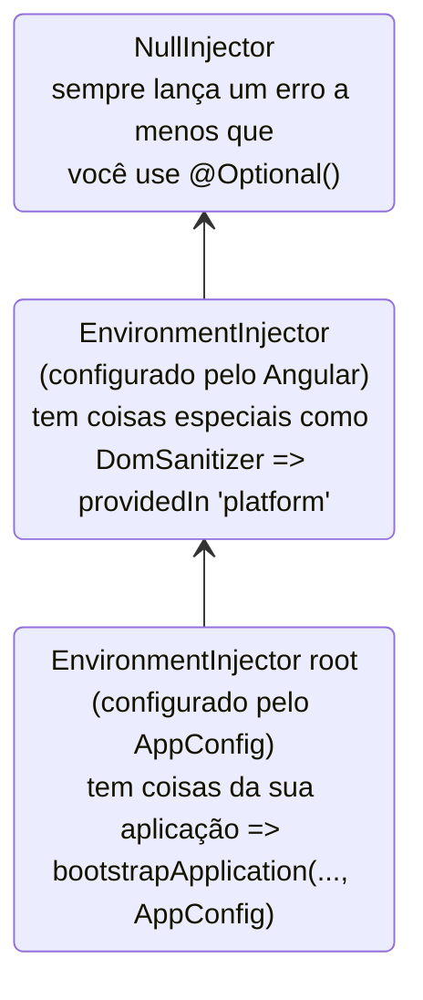
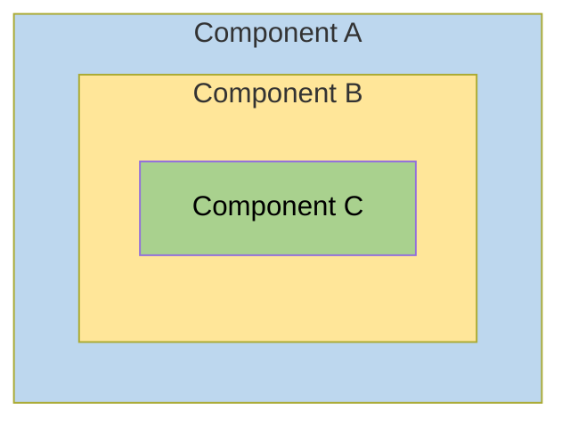
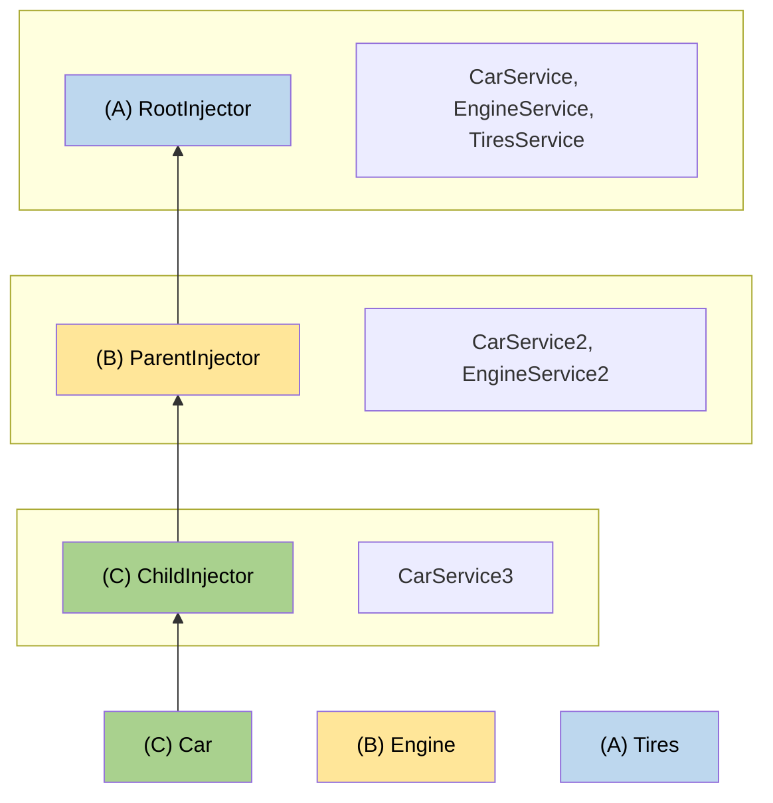

<!-- ia-translate: true -->
# Injetores hierárquicos

Este guia oferece uma cobertura aprofundada do sistema hierárquico de injeção de dependência do Angular, incluindo regras de resolução, modificadores e padrões avançados.

NOTE: Para conceitos básicos sobre a hierarquia de injetores e o escopo de providers, veja o [guia de definição de providers de dependência](guide/di/defining-dependency-providers#injector-hierarchy-in-angular).

## Tipos de hierarquias de injetores {#types-of-injector-hierarchies}

O Angular tem duas hierarquias de injetores:

| Hierarquias de injetores        | Detalhes                                                                                                                                                                                                  |
| :------------------------------ | :-------------------------------------------------------------------------------------------------------------------------------------------------------------------------------------------------------- |
| Hierarquia `EnvironmentInjector` | Configure um `EnvironmentInjector` nesta hierarquia usando `@Service()` ou o array `providers` em `ApplicationConfig`.                                                                                  |
| Hierarquia `ElementInjector`    | Criada implicitamente em cada elemento do DOM. Um `ElementInjector` fica vazio por padrão, a menos que você o configure na propriedade `providers` de `@Directive()` ou `@Component()`.                  |

<docs-callout title="Aplicações baseadas em NgModule">
Para aplicações baseadas em `NgModule`, você pode fornecer dependências com a hierarquia `ModuleInjector` usando a anotação `@NgModule()` ou `@Injectable()`.
</docs-callout>

### `EnvironmentInjector`

O `EnvironmentInjector` pode ser configurado de duas maneiras, usando:

- O `@Service()`
- O array `providers` do `ApplicationConfig`

<docs-callout title="Tree-shaking e @Service()">

Usar o decorator `@Service()` é preferível a usar o array `providers` do `ApplicationConfig`. Com `@Service`, as ferramentas de otimização podem fazer tree-shaking, que remove os services que a sua aplicação não está usando. Isso resulta em bundles menores.

O tree-shaking é especialmente útil para uma biblioteca, porque a aplicação que usa a biblioteca pode não precisar injetá-la.

</docs-callout>

O `EnvironmentInjector` é configurado pelo `ApplicationConfig.providers`.

Forneça services usando `@Service()` da seguinte forma:

```ts {highlight:[4]}
import {Service} from '@angular/core';

@Service() // <--provides this service in the root EnvironmentInjector
export class ItemService {
  name = 'telephone';
}
```

Os decorators `@Service()` ou `@Injectable()` identificam uma classe de service.

### ModuleInjector

No caso de aplicações baseadas em `NgModule`, o ModuleInjector pode ser configurado de uma de duas maneiras, usando:

- O decorator `@Service()`
- A propriedade `providedIn` do `@Injectable()`, referindo-se a `root` ou `platform`
- O array `providers` do `@NgModule()`

O `ModuleInjector` é configurado pelas propriedades `@NgModule.providers` e `NgModule.imports`. O `ModuleInjector` é um achatamento de todos os arrays de providers que podem ser alcançados seguindo `NgModule.imports` recursivamente.

Hierarquias filhas de `ModuleInjector` são criadas ao fazer lazy loading de outros `@NgModules`.

### Injetor da plataforma {#platform-injector}

Existem mais dois injetores acima do `root`: um `EnvironmentInjector` adicional e o `NullInjector()`.

Considere como o Angular inicializa a aplicação com o seguinte código em `main.ts`:

```ts
bootstrapApplication(App, appConfig);
```

O método `bootstrapApplication()` cria um injetor filho do injetor da plataforma, configurado pela instância de `ApplicationConfig`.
Esse é o `EnvironmentInjector` `root`.

O método `bootstrapApplication()` também cria (ou reutiliza) o injetor da plataforma, que contém dependências específicas da plataforma.
Isso permite que várias aplicações compartilhem uma configuração de plataforma.
Por exemplo, um navegador tem apenas uma barra de URL, não importa quantas aplicações estejam em execução.
Você pode configurar providers adicionais específicos da plataforma, no nível da plataforma, passando `extraProviders` pela função `platformBrowser()`.

O próximo injetor pai na hierarquia é o `NullInjector()`, que é o topo da árvore.
Se você subir tanto na árvore que estiver procurando um service no `NullInjector()`, receberá um erro, a menos que tenha usado `@Optional()`, porque, no fim, tudo termina no `NullInjector()`, que retorna um erro ou, no caso de `@Optional()`, `null`.
Para mais informações sobre `@Optional()`, veja a [seção `@Optional()`](#optional) deste guia.

O diagrama a seguir representa a relação entre o `ModuleInjector` `root` e seus injetores pais, conforme descrito nos parágrafos anteriores.



Embora o nome `root` seja um alias especial, outras hierarquias de `EnvironmentInjector` não têm aliases.
Você tem a opção de criar hierarquias de `EnvironmentInjector` sempre que um component carregado dinamicamente for criado, como acontece com o Router, que cria hierarquias filhas de `EnvironmentInjector`.

Todas as requisições são encaminhadas até o injetor root, quer você o tenha configurado com a instância de `ApplicationConfig` passada para o método `bootstrapApplication()`, quer tenha registrado todos os providers com `root` nos próprios services.

<docs-callout title="@Injectable() vs. ApplicationConfig">

Se você configurar um provider para toda a aplicação no `ApplicationConfig` do `bootstrapApplication`, ele sobrescreve o configurado para `root` nos metadados de `@Injectable()`.
Você pode fazer isso para configurar um provider não padrão de um service que é compartilhado por várias aplicações.

Aqui está um exemplo em que a configuração do router de components inclui uma [estratégia de localização](guide/routing/common-router-tasks#locationstrategy-and-browser-url-styles) não padrão, listando seu provider na lista `providers` do `ApplicationConfig`.

```ts
providers: [{provide: LocationStrategy, useClass: HashLocationStrategy}];
```

Para aplicações baseadas em `NgModule`, configure os providers de toda a aplicação no `providers` do `AppModule`.

</docs-callout>

### `ElementInjector`

O Angular cria hierarquias de `ElementInjector` implicitamente para cada elemento do DOM.

Fornecer um service no decorator `@Component()`, usando sua propriedade `providers` ou `viewProviders`, configura um `ElementInjector`.
Por exemplo, o `TestComponent` a seguir configura o `ElementInjector` ao fornecer o service desta forma:

```ts {highlight:[3]}
@Component({
  /* … */
  providers: [{ provide: ItemService, useValue: { name: 'lamp' } }]
})
export class TestComponent
```

HELPFUL: Veja a seção [regras de resolução](#resolution-rules) para entender a relação entre a árvore de `EnvironmentInjector`, o `ModuleInjector` e a árvore de `ElementInjector`.

Quando você fornece services em um component, esse service fica disponível pelo `ElementInjector` naquela instância do component.
Ele também pode ficar visível para components e directives filhos, de acordo com as regras de visibilidade descritas na seção [regras de resolução](#resolution-rules).

Quando a instância do component é destruída, a instância do service também é.

#### `@Directive()` e `@Component()` {#directive-and-component}

Um component é um tipo especial de directive, o que significa que, assim como `@Directive()` tem uma propriedade `providers`, `@Component()` também tem.
Isso significa que directives, assim como components, podem configurar providers usando a propriedade `providers`.
Quando você configura um provider para um component ou directive usando a propriedade `providers`, esse provider pertence ao `ElementInjector` desse component ou directive.
Components e directives no mesmo elemento compartilham um injetor.

## Regras de resolução {#resolution-rules}

Ao resolver um token para um component ou directive, o Angular faz isso em duas fases:

1. Nos pais na hierarquia de `ElementInjector`.
2. Nos pais na hierarquia de `EnvironmentInjector`.

Quando um component declara uma dependência, o Angular tenta satisfazê-la com o próprio `ElementInjector`.
Se o injetor do component não tiver o provider, ele passa a requisição para o `ElementInjector` do component pai.

As requisições continuam sendo encaminhadas até que o Angular encontre um injetor que possa atendê-las ou até que se esgotem as hierarquias de `ElementInjector` ancestrais.

Se o Angular não encontrar o provider em nenhuma hierarquia de `ElementInjector`, ele volta ao elemento de onde a requisição se originou e procura na hierarquia de `EnvironmentInjector`.
Se o Angular ainda não encontrar o provider, ele lança um erro.

Se você registrou um provider para o mesmo token de DI em níveis diferentes, o primeiro que o Angular encontrar é o que ele usa para resolver a dependência.
Se, por exemplo, um provider for registrado localmente no component que precisa do service,
o Angular não procura outro provider do mesmo service.

HELPFUL: Em aplicações baseadas em `NgModule`, o Angular procura na hierarquia de `ModuleInjector` caso não encontre um provider nas hierarquias de `ElementInjector`.

## Modificadores de resolução {#resolution-modifiers}

O comportamento de resolução do Angular pode ser modificado com `optional`, `self`, `skipSelf` e `host`.
Importe cada um deles de `@angular/core` e use-o na configuração de [`inject`](/api/core/inject) ao injetar seu service.

### Tipos de modificadores {#types-of-modifiers}

Os modificadores de resolução se dividem em três categorias:

- O que fazer se o Angular não encontrar o que você procura: `optional`
- Onde começar a procurar: `skipSelf`
- Onde parar de procurar: `host` e `self`

Por padrão, o Angular sempre começa no `Injector` atual e continua procurando até o topo.
Os modificadores permitem alterar o local inicial, ou _self_, e o local final da busca.

Além disso, você pode combinar todos os modificadores, exceto:

- `host` e `self`
- `skipSelf` e `self`

### `optional`

`optional` permite que o Angular considere opcional um service que você injeta.
Assim, se ele não puder ser resolvido em tempo de execução, o Angular resolve o service como `null`, em vez de lançar um erro.
No exemplo a seguir, o service `OptionalService` não é fornecido no service, no `ApplicationConfig`, no `@NgModule()` nem na classe do component, então ele não está disponível em lugar nenhum da aplicação.

```ts {header:"src/app/optional/optional.ts"}
export class Optional {
  public optional? = inject(OptionalService, {optional: true});
}
```

### `self`

Use `self` para que o Angular olhe apenas no `ElementInjector` do component ou directive atual.

Um bom caso de uso para `self` é injetar um service, mas somente se ele estiver disponível no elemento host atual.
Para evitar erros nessa situação, combine `self` com `optional`.

Por exemplo, no `SelfNoData` a seguir, observe o `LeafService` injetado como propriedade.

```ts {header: 'self-no-data.ts', highlight: [7]}
@Component({
  selector: 'app-self-no-data',
  templateUrl: './self-no-data.html',
  styleUrls: ['./self-no-data.css'],
})
export class SelfNoData {
  public leaf = inject(LeafService, {optional: true, self: true});
}
```

Neste exemplo, há um provider pai, e injetar o service retornaria o valor. No entanto, injetar o service com `self` e `optional` retorna `null`, porque `self` diz ao injetor para parar de procurar no elemento host atual.

Outro exemplo mostra a classe do component com um provider para `FlowerService`.
Nesse caso, o injetor não procura além do `ElementInjector` atual, porque encontra o `FlowerService` e retorna a tulipa 🌷.

```ts {header:"src/app/self/self.ts"}
@Component({
  selector: 'app-self',
  templateUrl: './self.html',
  styleUrls: ['./self.css'],
  providers: [{provide: FlowerService, useValue: {emoji: '🌷'}}],
})
export class Self {
  public flower = inject(FlowerService, {self: true});
}
```

### `skipSelf`

`skipSelf` é o oposto de `self`.
Com `skipSelf`, o Angular começa a procurar um service no `ElementInjector` pai, em vez do atual.
Assim, se o `ElementInjector` pai estivesse usando o valor samambaia <code>🌿</code> para `emoji`, mas você tivesse uma folha de bordo <code>🍁</code> no array `providers` do component, o Angular ignoraria a folha de bordo <code>🍁</code> e usaria a samambaia <code>🌿</code>.

Para ver isso em código, suponha que o valor a seguir para `emoji` seja o que o component pai está usando, como neste service:

```ts {header: 'leaf.service.ts'}
export class LeafService {
  emoji = '🌿';
}
```

Imagine que, no component filho, você tenha um valor diferente, a folha de bordo 🍁, mas queira usar o valor do pai. É nesse caso que você usaria `skipSelf`:

```ts {header:"skipself.ts" highlight:[[6],[10]]}
@Component({
  selector: 'app-skipself',
  templateUrl: './skipself.html',
  styleUrls: ['./skipself.css'],
  // Angular would ignore this LeafService instance
  providers: [{provide: LeafService, useValue: {emoji: '🍁'}}],
})
export class Skipself {
  // Use skipSelf as inject option
  public leaf = inject(LeafService, {skipSelf: true});
}
```

Neste caso, o valor que você obteria para `emoji` seria a samambaia <code>🌿</code>, não a folha de bordo <code>🍁</code>.

#### Opção `skipSelf` com `optional` {#skipself-option-with-optional}

Use a opção `skipSelf` com `optional` para evitar um erro caso o valor seja `null`.

No exemplo a seguir, o service `Person` é injetado durante a inicialização da propriedade.
`skipSelf` diz ao Angular para pular o injetor atual, e `optional` evita um erro caso o service `Person` seja `null`.

```ts
class Person {
  parent = inject(Person, {optional: true, skipSelf: true});
}
```

### `host`

<!-- TODO: Remove ambiguity between host and self. -->

`host` permite que você designe um component como a última parada na árvore de injetores ao procurar providers.

Mesmo que exista uma instância do service mais acima na árvore, o Angular não continua procurando.
Use `host` da seguinte forma:

```ts {header:"host.ts" highlight:[[6],[9]]}
@Component({
  selector: 'app-host',
  templateUrl: './host.html',
  styleUrls: ['./host.css'],
  // provide the service
  providers: [{provide: FlowerService, useValue: {emoji: '🌷'}}],
})
export class Host {
  // use host when injecting the service
  flower = inject(FlowerService, {host: true, optional: true});
}
```

Como `Host` tem a opção `host`, não importa qual valor de `flower.emoji` o pai de `Host` tenha, `Host` usará a tulipa <code>🌷</code>.

### Modificadores com injeção via constructor {#modifiers-with-constructor-injection}

De maneira semelhante ao que foi apresentado antes, o comportamento da injeção via constructor pode ser modificado com `@Optional()`, `@Self()`, `@SkipSelf()` e `@Host()`.

Importe cada um deles de `@angular/core` e use-os no constructor da classe do component ao injetar seu service.

```ts {header:"self-no-data.ts" highlight:[2]}
export class SelfNoData {
  constructor(@Self() @Optional() public leaf?: LeafService) {}
}
```

## Estrutura lógica do template {#logical-structure-of-the-template}

Quando você fornece services na classe do component, os services ficam visíveis dentro da árvore de `ElementInjector`, de acordo com onde e como você os fornece.

Entender a estrutura lógica subjacente do template do Angular dará a você uma base para configurar services e, por consequência, controlar a visibilidade deles.

Components são usados nos seus templates, como no exemplo a seguir:

```html
<app-root> <app-child />; </app-root>
```

HELPFUL: Normalmente, você declara os components e seus templates em arquivos separados.
Para entender como o sistema de injeção funciona, é útil olhá-los do ponto de vista de uma árvore lógica combinada.
O termo _lógica_ a distingue da árvore de renderização, que é a árvore DOM da sua aplicação.
Para marcar os locais onde os templates dos components estão, este guia usa o pseudoelemento `<#VIEW>`, que não existe de fato na árvore de renderização e está presente apenas como modelo mental.

A seguir, um exemplo de como as árvores de view de `<app-root>` e `<app-child>` são combinadas em uma única árvore lógica:

```html
<app-root>
  <#VIEW>
    <app-child>
     <#VIEW>
       …content goes here…
     </#VIEW>
    </app-child>
  </#VIEW>
</app-root>
```

Entender a ideia da delimitação `<#VIEW>` é especialmente importante quando você configura services na classe do component.

## Exemplo: fornecendo services em `@Component()` {#example-providing-services-in-component}

A forma como você fornece services usando o decorator `@Component()` (ou `@Directive()`) determina a visibilidade deles.
As seções a seguir demonstram `providers` e `viewProviders`, junto com maneiras de modificar a visibilidade do service com `skipSelf` e `host`.

Uma classe de component pode fornecer services de duas maneiras:

| Arrays                       | Detalhes                                       |
| :--------------------------- | :--------------------------------------------- |
| Com um array `providers`     | `@Component({ providers: [SomeService] })`     |
| Com um array `viewProviders` | `@Component({ viewProviders: [SomeService] })` |

Nos exemplos abaixo, você verá a árvore lógica de uma aplicação Angular.
Para ilustrar como o injetor funciona no contexto dos templates, a árvore lógica representará a estrutura HTML da aplicação.
Por exemplo, a árvore lógica mostrará que `<child-component>` é filho direto de `<parent-component>`.

Na árvore lógica, você verá atributos especiais: `@Provide`, `@Inject` e `@ApplicationConfig`.
Esses não são atributos reais, mas estão aqui para demonstrar o que acontece por trás dos panos.

| Atributo de service do Angular | Detalhes                                                                                  |
| :----------------------------- | :---------------------------------------------------------------------------------------- |
| `@Inject(Token)=>Value`        | Se `Token` for injetado nesta localização da árvore lógica, seu valor seria `Value`.      |
| `@Provide(Token=Value)`        | Indica que `Token` é fornecido com `Value` nesta localização da árvore lógica.            |
| `@ApplicationConfig`           | Demonstra que um `EnvironmentInjector` de fallback deve ser usado nesta localização.      |

### Estrutura da aplicação de exemplo {#example-app-structure}

A aplicação de exemplo tem um `FlowerService` fornecido em `root`, com o valor `emoji` de hibisco vermelho <code>🌺</code>.

```ts {header:"flower.service.ts"}
@Service()
export class FlowerService {
  emoji = '🌺';
}
```

Considere uma aplicação com apenas um `App` e um `Child`.
A view renderizada mais básica se pareceria com elementos HTML aninhados, como o seguinte:

```html
<app-root>
  <!-- App selector -->
  <app-child> <!-- Child selector --> </app-child>
</app-root>
```

No entanto, nos bastidores, o Angular usa uma representação lógica da view da seguinte forma ao resolver requisições de injeção:

```html
<app-root @ApplicationConfig
        @Inject(FlowerService) flower=>"🌺">
  <#VIEW>
    <p>Emoji from FlowerService: {{flower.emoji}} (🌺)</p>
    <app-child>
      <#VIEW>
      </#VIEW>
    </app-child>
  </#VIEW>
</app-root>
```

O `<#VIEW>` aqui representa uma instância de um template.
Observe que cada component tem a sua própria `<#VIEW>`.

Conhecer essa estrutura pode orientar como você fornece e injeta seus services, e dar controle total sobre a visibilidade deles.

Agora, considere que `<app-root>` injeta o `FlowerService`:

```typescript
export class App {
  flower = inject(FlowerService);
}
```

Adicione um binding ao template de `<app-root>` para visualizar o resultado:

```html
<p>Emoji from FlowerService: {{flower.emoji}}</p>
```

A saída na view seria:

```text {hideCopy}
Emoji from FlowerService: 🌺
```

Na árvore lógica, isso seria representado da seguinte forma:

```html
<app-root @ApplicationConfig
        @Inject(FlowerService) flower=>"🌺">
  <#VIEW>
    <p>Emoji from FlowerService: {{flower.emoji}} (🌺)</p>
    <app-child>
      <#VIEW>
      </#VIEW>
    </app-child>
  </#VIEW>
</app-root>
```

Quando `<app-root>` requisita o `FlowerService`, cabe ao injetor resolver o token `FlowerService`.
A resolução do token acontece em duas fases:

1. O injetor determina o local inicial na árvore lógica e o local final da busca.
   O injetor começa no local inicial e procura o token em cada nível de view da árvore lógica.
   Se o token for encontrado, ele é retornado.

1. Se o token não for encontrado, o injetor procura o `EnvironmentInjector` pai mais próximo para delegar a requisição.

No caso do exemplo, as restrições são:

1. Comece na `<#VIEW>` pertencente a `<app-root>` e termine em `<app-root>`.
   - Normalmente, o ponto inicial da busca é o ponto da injeção.
     No entanto, neste caso `<app-root>` é um component. Os `@Component`s são especiais porque também incluem as próprias `viewProviders`, e é por isso que a busca começa na `<#VIEW>` pertencente a `<app-root>`.
     Isso não aconteceria com uma directive associada no mesmo local.
   - O local final coincide com o próprio component, porque ele é o component mais alto desta aplicação.

1. O `EnvironmentInjector` fornecido pelo `ApplicationConfig` atua como injetor de fallback quando o token de injeção não é encontrado nas hierarquias de `ElementInjector`.

### Usando o array `providers` {#using-the-providers-array}

Agora, na classe `Child`, adicione um provider para `FlowerService` para demonstrar regras de resolução mais complexas nas seções seguintes:

```ts
@Component({
  selector: 'app-child',
  templateUrl: './child.html',
  styleUrls: ['./child.css'],
  // use the providers array to provide a service
  providers: [{provide: FlowerService, useValue: {emoji: '🌻'}}],
})
export class Child {
  // inject the service
  flower = inject(FlowerService);
}
```

Agora que o `FlowerService` é fornecido no decorator `@Component()`, quando `<app-child>` requisita o service, o injetor só precisa olhar até o `ElementInjector` de `<app-child>`.
Ele não precisa continuar a busca pela árvore de injetores.

O próximo passo é adicionar um binding ao template de `Child`.

```html
<p>Emoji from FlowerService: {{flower.emoji}}</p>
```

Para renderizar os novos valores, adicione `<app-child>` ao final do template de `App`, para que a view também exiba o girassol:

```text {hideCopy}
Child Component
Emoji from FlowerService: 🌻
```

Na árvore lógica, isso é representado da seguinte forma:

```html
<app-root @ApplicationConfig
          @Inject(FlowerService) flower=>"🌺">
  <#VIEW>

  <p>Emoji from FlowerService: {{flower.emoji}} (🌺)</p>
  <app-child @Provide(FlowerService="🌻" )
             @Inject(FlowerService)=>"🌻"> <!-- search ends here -->
    <#VIEW> <!-- search starts here -->
    <h2>Child Component</h2>
    <p>Emoji from FlowerService: {{flower.emoji}} (🌻)</p>
  </
  #VIEW>
  </app-child>
</#VIEW>
</app-root>
```

Quando `<app-child>` requisita o `FlowerService`, o injetor começa a busca na `<#VIEW>` pertencente a `<app-child>` \(a `<#VIEW>` está incluída porque é injetada a partir de `@Component()`\) e termina em `<app-child>`.
Nesse caso, o `FlowerService` é resolvido pelo array `providers` de `<app-child>`, com o girassol <code>🌻</code>.
O injetor não precisa olhar mais adiante na árvore de injetores.
Ele para assim que encontra o `FlowerService` e nunca vê o hibisco vermelho <code>🌺</code>.

### Usando o array `viewProviders` {#using-the-viewproviders-array}

Use o array `viewProviders` como outra forma de fornecer services no decorator `@Component()`.
Usar `viewProviders` torna os services visíveis dentro da `<#VIEW>`.

HELPFUL: Os passos são os mesmos de usar o array `providers`, com a diferença de usar o array `viewProviders` no lugar.

Para instruções passo a passo, continue nesta seção.
Se você conseguir montar o exemplo sozinho, pule para [Modificando a disponibilidade do service](#visibility-of-provided-tokens).

Para demonstração, vamos construir um `AnimalService` para exemplificar `viewProviders`.
Primeiro, crie um `AnimalService` com a propriedade `emoji` com o valor de baleia <code>🐳</code>:

```typescript
import {Service} from '@angular/core';

@Service()
export class AnimalService {
  emoji = '🐳';
}
```

Seguindo o mesmo padrão do `FlowerService`, injete o `AnimalService` na classe `App`:

```ts
export class App {
  public flower = inject(FlowerService);
  public animal = inject(AnimalService);
}
```

HELPFUL: Você pode deixar todo o código relacionado ao `FlowerService` no lugar, pois ele permitirá uma comparação com o `AnimalService`.

Adicione um array `viewProviders` e injete o `AnimalService` também na classe `Child`, mas dê à `emoji` um valor diferente.
Aqui, o valor é o de cachorro 🐶.

```typescript
@Component({
  selector: 'app-child',
  templateUrl: './child.html',
  styleUrls: ['./child.css'],
  // provide services
  providers: [{provide: FlowerService, useValue: {emoji: '🌻'}}],
  viewProviders: [{provide: AnimalService, useValue: {emoji: '🐶'}}],
})
export class Child {
  // inject services
  flower = inject(FlowerService);
  animal = inject(AnimalService);
}
```

Adicione bindings aos templates de `Child` e de `App`.
No template de `Child`, adicione o seguinte binding:

```html
<p>Emoji from AnimalService: {{animal.emoji}}</p>
```

Além disso, adicione o mesmo ao template de `App`:

```html
<p>Emoji from AnimalService: {{animal.emoji}}</p>
```

Agora você deve ver os dois valores no navegador:

```text {hideCopy}
App
Emoji from AnimalService: 🐳

Child Component
Emoji from AnimalService: 🐶
```

A árvore lógica deste exemplo de `viewProviders` fica assim:

```html
<app-root @ApplicationConfig
          @Inject(AnimalService) animal=>"🐳">
  <#VIEW>
  <app-child>
    <#VIEW @Provide(AnimalService="🐶")
    @Inject(AnimalService=>"🐶")>

    <!-- ^^using viewProviders means AnimalService is available in <#VIEW>-->
    <p>Emoji from AnimalService: {{animal.emoji}} (🐶)</p>
  </
  #VIEW>
  </app-child>
</#VIEW>
</app-root>
```

Assim como no exemplo do `FlowerService`, o `AnimalService` é fornecido no decorator `@Component()` de `<app-child>`.
Isso significa que, como o injetor procura primeiro no `ElementInjector` do component, ele encontra o valor do cachorro <code>🐶</code> do `AnimalService`.
Ele não precisa continuar a busca na árvore de `ElementInjector`, nem precisa procurar no `ModuleInjector`.

### `providers` vs. `viewProviders` {#providers-vs-viewproviders}

O campo `viewProviders` é conceitualmente semelhante a `providers`, mas há uma diferença notável.
Os providers em `viewProviders` só são visíveis dentro da própria view do component: o conteúdo projetado no component via `<ng-content>` não consegue vê-los.

Para ver a diferença entre usar `providers` e `viewProviders`, adicione outro component ao exemplo e chame-o de `Inspector`.
`Inspector` será filho de `Child`.
Em `inspector.ts`, injete `FlowerService` e `AnimalService` durante a inicialização das propriedades:

```typescript
export class Inspector {
  flower = inject(FlowerService);
  animal = inject(AnimalService);
}
```

Você não precisa de um array `providers` nem de `viewProviders`.
Em seguida, em `inspector.html`, adicione a mesma marcação dos components anteriores:

```html
<p>Emoji from FlowerService: {{flower.emoji}}</p>
<p>Emoji from AnimalService: {{animal.emoji}}</p>
```

Lembre-se de adicionar o `Inspector` ao array `imports` de `Child`.

```ts
@Component({
  ...
  imports: [Inspector]
})
```

Em seguida, adicione o seguinte a `child.html`:

```html
...

<div class="container">
  <h3>Content projection</h3>
  <ng-content />
</div>
<h3>Inside the view</h3>

<app-inspector />
```

O `<ng-content>` permite projetar conteúdo, e o `<app-inspector>` dentro do template de `Child` faz do `Inspector` um component filho de `Child`.

Depois, adicione o seguinte a `app.html` para aproveitar a projeção de conteúdo:

```html
<app-child>
  <app-inspector />
</app-child>
```

O navegador agora renderiza o seguinte, omitindo os exemplos anteriores para simplificar:

```text {hideCopy}
...
Content projection

Emoji from FlowerService: 🌻
Emoji from AnimalService: 🐳

Emoji from FlowerService: 🌻
Emoji from AnimalService: 🐶
```

Esses quatro bindings demonstram a diferença entre `providers` e `viewProviders`.
Lembre-se de que o emoji de cachorro <code>🐶</code> é declarado dentro da `<#VIEW>` de `Child` e não é visível para o conteúdo projetado.
Em vez disso, o conteúdo projetado vê a baleia <code>🐳</code>.

Você pode se perguntar por que o `<app-inspector>` projetado ainda consegue ver a <code>🐳</code>, que é o `AnimalService` fornecido pela raiz.
O motivo é que a DI do Angular acompanha **onde um component foi declarado**, não onde ele acaba sendo renderizado.
O `<app-inspector>` está no template de `App`, dentro da `<#VIEW>` de `App`, então sua busca nunca passa pela `<#VIEW>` de `Child`.
Projetá-lo em `Child` corta o acesso às `viewProviders` de `Child` (<code>🐶</code>), mas o `AnimalService` da raiz (<code>🐳</code>) continua acessível subindo na árvore.

Já na próxima seção de saída, porém, o `Inspector` é um component filho real de `Child`: ele está dentro da `<#VIEW>`, então, quando pede o `AnimalService`, vê o cachorro <code>🐶</code>.

O `AnimalService` na árvore lógica ficaria assim:

```html
<app-root @ApplicationConfig
          @Inject(AnimalService) animal=>"🐳">
  <#VIEW>
  <app-child>
    <#VIEW @Provide(AnimalService="🐶")
    @Inject(AnimalService=>"🐶")>

    <!-- ^^using viewProviders means AnimalService is available in <#VIEW>-->
    <p>Emoji from AnimalService: {{animal.emoji}} (🐶)</p>

    <div class="container">
      <h3>Content projection</h3>
      <app-inspector @Inject(AnimalService) animal=>"🐳">
        <p>Emoji from AnimalService: {{animal.emoji}} (🐳)</p>
      </app-inspector>
    </div>

    <app-inspector>
      <#VIEW @Inject(AnimalService) animal=>"🐶">
      <p>Emoji from AnimalService: {{animal.emoji}} (🐶)</p>
    </
    #VIEW>
    </app-inspector>
  </
  #VIEW>
  </app-child>

</#VIEW>
</app-root>
```

O `<app-inspector>` projetado recebe <code>🐳</code>, porque <code>🐶</code> pertence à view de `Child`, e o conteúdo projetado não consegue alcançá-la.
A <code>🐳</code> é acessível porque o `<app-inspector>` foi declarado no template de `App`, então ainda consegue subir até o `AnimalService` da raiz.

O `<app-inspector>` que fica diretamente dentro do template de `Child` (não projetado) recebe <code>🐶</code>, porque está dentro da `<#VIEW>`, então não há fronteira a ser atravessada.

### Dando acesso a um injetor de view ao conteúdo projetado {#giving-projected-content-access-to-a-view-injector}

O conteúdo projetado com `<ng-content>` não consegue ver as `viewProviders` de um component, porque o Angular resolve a injeção no injetor onde o conteúdo é declarado, não onde ele é renderizado.

Quando você quiser especificamente que o conteúdo projetado alcance um service no nível da view, ou a própria instância do component que faz a projeção, aceite o conteúdo como template em vez de `<ng-content>` e renderize-o com um injetor explícito.

Atualize `Child` para fornecer `AnimalService` em `viewProviders`, consulte o template projetado e renderize-o por meio de [`NgTemplateOutlet`](/api/common/NgTemplateOutlet), com `ngTemplateOutletInjector` definido como um injetor que consiga ver esse service:

```ts
@Component({
  selector: 'app-child',
  viewProviders: [AnimalService],
  imports: [NgTemplateOutlet],
  template: `
    <ng-container [ngTemplateOutlet]="content()" [ngTemplateOutletInjector]="injector" />
  `,
})
export class Child {
  readonly content = contentChild.required(TemplateRef);
  readonly injector = inject(Injector);
}
```

O consumidor envolve a marcação projetada em um `<ng-template>`:

```html
<app-child>
  <ng-template>
    <app-inspector />
  </ng-template>
</app-child>
```

Agora, `Child` cria o `<app-inspector>` no outlet usando o próprio injetor, então `AnimalService` resolve para o cachorro <code>🐶</code>, mesmo que a marcação esteja escrita no template de `App`. O custo é um pouco mais de marcação dos dois lados, em comparação com `<ng-content>`.

### Visibilidade de tokens fornecidos {#visibility-of-provided-tokens}

Os decorators de visibilidade influenciam onde a busca pelo token de injeção começa e termina na árvore lógica.
Para isso, coloque a configuração de visibilidade no ponto de injeção, ou seja, ao chamar `inject()`, e não no ponto de declaração.

Para alterar onde o injetor começa a procurar o `FlowerService`, adicione `skipSelf` à chamada de `inject()` de `<app-child>` onde o `FlowerService` é injetado.
Essa chamada é um inicializador de propriedade em `<app-child>`, como mostrado em `child.ts`:

```typescript
flower = inject(FlowerService, {skipSelf: true});
```

Com `skipSelf`, o injetor de `<app-child>` não olha para si mesmo em busca do `FlowerService`.
Em vez disso, o injetor começa a procurar o `FlowerService` no `ElementInjector` de `<app-root>`, onde não encontra nada.
Depois, volta ao `ModuleInjector` de `<app-child>` e encontra o valor do hibisco vermelho <code>🌺</code>, que está disponível porque `<app-child>` e `<app-root>` compartilham o mesmo `ModuleInjector`.
A interface renderiza o seguinte:

```text {hideCopy}
Emoji from FlowerService: 🌺
```

Em uma árvore lógica, essa mesma ideia pode ser representada assim:

```html
<app-root @ApplicationConfig
          @Inject(FlowerService) flower=>"🌺">
  <#VIEW>
  <app-child @Provide(FlowerService="🌻" )>
    <#VIEW @Inject(FlowerService, SkipSelf)=>"🌺">

    <!-- With SkipSelf, the injector looks to the next injector up the tree (app-root) -->

  </
  #VIEW>
  </app-child>
</#VIEW>
</app-root>
```

Embora `<app-child>` forneça o girassol <code>🌻</code>, a aplicação renderiza o hibisco vermelho <code>🌺</code>, porque `skipSelf` faz o injetor atual (`app-child`) pular a si mesmo e olhar para o pai.

Se você agora adicionar `host` (além de `skipSelf`), o resultado será `null`.
Isso acontece porque `host` limita o limite superior da busca à `<#VIEW>` de `app-child`.
Aqui está a ideia na árvore lógica:

```html
<app-root @ApplicationConfig
          @Inject(FlowerService) flower=>"🌺">
  <#VIEW> <!-- end search here with null-->
  <app-child @Provide(FlowerService="🌻" )> <!-- start search here -->
    <#VIEW inject(FlowerService, {skipSelf: true, host: true, optional:true})=>null>
  </
  #VIEW>
  </app-parent>
</#VIEW>
</app-root>
```

Aqui, os services e seus valores são os mesmos, mas `host` impede o injetor de procurar além da `<#VIEW>` pelo `FlowerService`, então ele não o encontra e retorna `null`.

### `skipSelf` e `viewProviders` {#skipself-and-viewproviders}

Lembre-se de que `<app-child>` fornece o `AnimalService` no array `viewProviders` com o valor do cachorro <code>🐶</code>.
Como o injetor só precisa olhar o `ElementInjector` de `<app-child>` para o `AnimalService`, ele nunca vê a baleia <code>🐳</code>.

Como no exemplo do `FlowerService`, se você adicionar `skipSelf` ao `inject()` do `AnimalService`, o injetor não procurará o `AnimalService` no `ElementInjector` do `<app-child>` atual.
Em vez disso, o injetor começará no `ElementInjector` de `<app-root>`.

```typescript
@Component({
  selector: 'app-child',
  …
  viewProviders: [
    { provide: AnimalService, useValue: { emoji: '🐶' } },
  ],
})
```

Com `skipSelf` em `<app-child>`, a árvore lógica fica assim:

```html
<app-root @ApplicationConfig
          @Inject(AnimalService=>"🐳")>
  <#VIEW><!-- search begins here -->
  <app-child>
    <#VIEW @Provide(AnimalService="🐶")
    @Inject(AnimalService, SkipSelf=>"🐳")>

    <!--Add skipSelf -->

  </
  #VIEW>
  </app-child>
</#VIEW>
</app-root>
```

Com `skipSelf` em `<app-child>`, o injetor começa a busca pelo `AnimalService` no `ElementInjector` de `<app-root>` e encontra a baleia 🐳.

### `host` e `viewProviders` {#host-and-viewproviders}

Se você usar apenas `host` na injeção de `AnimalService`, o resultado é o cachorro <code>🐶</code>, porque o injetor encontra o `AnimalService` na própria `<#VIEW>` de `<app-child>`.
`Child` configura as `viewProviders` para que o emoji de cachorro seja fornecido como valor de `AnimalService`.
Você também pode ver `host` na chamada de `inject()`:

```typescript
@Component({
  selector: 'app-child',
  …
  viewProviders: [
    { provide: AnimalService, useValue: { emoji: '🐶' } },
  ]
})
export class Child {
  animal = inject(AnimalService, { host: true })
}
```

`host: true` faz o injetor procurar até encontrar a borda da `<#VIEW>`.

```html
<app-root @ApplicationConfig
          @Inject(AnimalService=>"🐳")>
  <#VIEW>
  <app-child>
    <#VIEW @Provide(AnimalService="🐶")
    inject(AnimalService, {host: true}=>"🐶")> <!-- host stops search here -->
  </
  #VIEW>
  </app-child>
</#VIEW>
</app-root>
```

Adicione um array `viewProviders` com um terceiro animal, um ouriço <code>🦔</code>, aos metadados de `@Component()` de `app.ts`:

```typescript
@Component({
  selector: 'app-root',
  templateUrl: './app.html',
  styleUrls: [ './app.css' ],
  viewProviders: [
    { provide: AnimalService, useValue: { emoji: '🦔' } },
  ],
})
```

Em seguida, adicione `skipSelf` junto com `host` à chamada de `inject()` da injeção de `AnimalService` em `child.ts`.
Aqui estão `host` e `skipSelf` na inicialização da propriedade `animal`:

```typescript
export class Child {
  animal = inject(AnimalService, {host: true, skipSelf: true});
}
```

<!-- TODO: This requires a rework. It seems not well explained what `viewProviders`/`injectors` is here
  and how `host` works.
 -->

Quando `host` e `skipSelf` foram aplicados ao `FlowerService`, que está no array `providers`, o resultado foi `null`, porque `skipSelf` começa a busca no injetor de `<app-child>`, mas `host` para a busca em `<#VIEW>`, onde não há `FlowerService`.
Na árvore lógica, você pode ver que o `FlowerService` é visível em `<app-child>`, não na sua `<#VIEW>`.

No entanto, o `AnimalService`, que é fornecido pelo array `viewProviders` de `App`, está visível.

A representação na árvore lógica mostra por quê:

```html
<app-root @ApplicationConfig
          @Inject(AnimalService=>"🐳")>
  <#VIEW @Provide(AnimalService="🦔")
  @Inject(AnimalService, @Optional)=>"🦔">

  <!-- ^^skipSelf starts here,  host stops here^^ -->
  <app-child>
    <#VIEW @Provide(AnimalService="🐶")
    inject(AnimalService, {skipSelf:true, host: true, optional: true})=>"🦔">
    <!-- Add skipSelf ^^-->
  </
  #VIEW>
  </app-child>
</#VIEW>
</app-root>
```

O `skipSelf` faz o injetor começar a busca pelo `AnimalService` no `<app-root>`, e não no `<app-child>`, onde a requisição se origina, e o `host` interrompe a busca na `<#VIEW>` de `<app-root>`.
Como o `AnimalService` é fornecido pelo array `viewProviders`, o injetor encontra o ouriço <code>🦔</code> na `<#VIEW>`.

## Exemplo: casos de uso do `ElementInjector` {#example-elementinjector-use-cases}

A capacidade de configurar um ou mais providers em diferentes níveis abre possibilidades úteis.

### Cenário: isolamento de services {#scenario-service-isolation}

Razões de arquitetura podem levar você a restringir o acesso a um service ao domínio da aplicação ao qual ele pertence.
Por exemplo, considere que construímos um `VillainsList`, que exibe uma lista de vilões.
Ele obtém esses vilões de um `VillainsService`.

Se você fornecer o `VillainsService` no `AppModule` raiz, ele ficará visível em toda a aplicação.
Se você modificar o `VillainsService` depois, poderá quebrar algo em outros components que passaram a depender desse service sem querer.

Em vez disso, você deve fornecer o `VillainsService` nos metadados `providers` de `VillainsList`, assim:

```typescript
@Component({
  selector: 'app-villains-list',
  templateUrl: './villains-list.html',
  providers: [VillainsService],
})
export class VillainsList {}
```

Ao fornecer o `VillainsService` nos metadados de `VillainsList` e em nenhum outro lugar, o service fica disponível somente em `VillainsList` e na sua árvore de subcomponents.

O `VillainsService` é um singleton em relação a `VillainsList`, porque é ali que ele é declarado.
Enquanto `VillainsList` não for destruído, será a mesma instância de `VillainsService`. Mas, se houver várias instâncias de `VillainsList`, cada uma terá sua própria instância de `VillainsService`.

### Cenário: múltiplas sessões de edição {#scenario-multiple-edit-sessions}

Muitas aplicações permitem que os usuários trabalhem em várias tarefas abertas ao mesmo tempo.
Por exemplo, em uma aplicação de preparação de declarações de imposto, o preparador pode estar trabalhando em várias declarações, alternando entre elas ao longo do dia.

Para demonstrar esse cenário, imagine um `HeroList` que exibe uma lista de super-heróis.

Para abrir a declaração de imposto de um herói, o preparador clica no nome do herói, o que abre um component para editar essa declaração.
Cada declaração de herói selecionada abre no próprio component, e várias declarações podem estar abertas ao mesmo tempo.

Cada component de declaração de imposto tem as seguintes características:

- É a sua própria sessão de edição da declaração
- Pode alterar uma declaração sem afetar a declaração em outro component
- Tem a capacidade de salvar as alterações da declaração ou cancelá-las

Suponha que o `HeroTaxReturnEditor` tivesse lógica para gerenciar e restaurar alterações.
Isso seria uma tarefa simples para a declaração de um herói.
No mundo real, com um modelo de dados de declaração de imposto rico, o gerenciamento de alterações seria complicado.
Você pode delegar esse gerenciamento a um service auxiliar, como este exemplo faz.

O `HeroTaxReturnService` armazena em cache uma única `HeroTaxReturn`, acompanha as alterações nessa declaração e pode salvá-la ou restaurá-la.
Ele também delega ao `HeroService`, um singleton de toda a aplicação, que obtém por injeção.

```typescript
import {inject, Service} from '@angular/core';
import {HeroTaxReturn} from './hero';
import {HeroesService} from './heroes.service';

@Service({autoProvided: false})
export class HeroTaxReturnService {
  private currentTaxReturn!: HeroTaxReturn;
  private originalTaxReturn!: HeroTaxReturn;

  private heroService = inject(HeroesService);

  set taxReturn(htr: HeroTaxReturn) {
    this.originalTaxReturn = htr;
    this.currentTaxReturn = htr.clone();
  }

  get taxReturn(): HeroTaxReturn {
    return this.currentTaxReturn;
  }

  restoreTaxReturn() {
    this.taxReturn = this.originalTaxReturn;
  }

  saveTaxReturn() {
    this.taxReturn = this.currentTaxReturn;
    this.heroService.saveTaxReturn(this.currentTaxReturn).subscribe();
  }
}
```

Aqui está o `HeroTaxReturnEditor`, que usa o `HeroTaxReturnService`.

```typescript
import {Component, effect, inject, input, output} from '@angular/core';
import {HeroTaxReturn} from './hero';
import {HeroTaxReturnService} from './hero-tax-return.service';

@Component({
  selector: 'app-hero-tax-return',
  templateUrl: './hero-tax-return.html',
  styleUrls: ['./hero-tax-return.css'],
  providers: [HeroTaxReturnService],
})
export class HeroTaxReturnEditor {
  message = '';

  close = output<void>();

  taxReturn = input.required<HeroTaxReturn>();

  private heroTaxReturnService = inject(HeroTaxReturnService);

  constructor() {
    effect(() => {
      this.heroTaxReturnService.taxReturn = this.taxReturn();
    });
  }

  onCanceled() {
    this.flashMessage('Canceled');
    this.heroTaxReturnService.restoreTaxReturn();
  }

  onClose() {
    this.close.emit();
  }

  onSaved() {
    this.flashMessage('Saved');
    this.heroTaxReturnService.saveTaxReturn();
  }

  flashMessage(msg: string) {
    this.message = msg;
    setTimeout(() => (this.message = ''), 500);
  }
}
```

A _declaração a ser editada_ chega pelo signal input `taxReturn`.
Um `effect` inicializa a instância própria do `HeroTaxReturnService` do component com a declaração recebida sempre que o input muda.
O getter do service sempre retorna o que o service considera o estado atual do herói.
O component também pede ao service que salve e restaure essa declaração.

Isso não funcionaria se o service fosse um singleton de toda a aplicação.
Cada component compartilharia a mesma instância do service, e cada um sobrescreveria a declaração de imposto que pertence a outro herói.

Para evitar isso, configure o injetor no nível do component do `HeroTaxReturnEditor` para fornecer o service, usando a propriedade `providers` nos metadados do component.

```typescript
providers: [HeroTaxReturnService];
```

O `HeroTaxReturnEditor` tem seu próprio provider do `HeroTaxReturnService`.
Lembre-se de que cada _instância_ de component tem seu próprio injetor.
Fornecer o service no nível do component garante que _cada_ instância do component receba uma instância privada do service. Isso garante que nenhuma declaração de imposto seja sobrescrita.

HELPFUL: O restante do código do cenário depende de outros recursos e técnicas do Angular, que você pode estudar em outras partes da documentação.

### Cenário: providers especializados {#scenario-specialized-providers}

Outro motivo para fornecer um service novamente em outro nível é substituir a implementação por uma _mais especializada_ do service, mais fundo na árvore de components.

Por exemplo, considere um component `Car` que inclui informações sobre serviços de pneus e depende de outros services para fornecer mais detalhes sobre o carro.

O injetor raiz, marcado como (A), usa providers _genéricos_ para detalhes sobre `CarService` e `EngineService`.

1. Component `Car` (A). O component (A) exibe dados de serviço de pneus sobre um carro e especifica services genéricos para fornecer mais informações sobre o carro.

2. Component filho (B). O component (B) define seus próprios providers _especializados_ para `CarService` e `EngineService`, com recursos especiais adequados ao que acontece no component (B).

3. Component filho (C), filho do component (B). O component (C) define seu próprio provider, ainda _mais especializado_, para `CarService`.



Nos bastidores, cada component configura o próprio injetor com zero, um ou mais providers definidos para o próprio component.

Quando você resolve uma instância de `Car` no component mais profundo (C), o injetor dele produz:

- Uma instância de `Car` resolvida pelo injetor (C)
- Um `Engine` resolvido pelo injetor (B)
- Seus `Tires` resolvidos pelo injetor raiz (A).



## Mais sobre injeção de dependência {#more-on-dependency-injection}

<docs-pill-row>
  <docs-pill href="/guide/di/defining-dependency-providers" title="Providers de DI"/>
</docs-pill-row>
