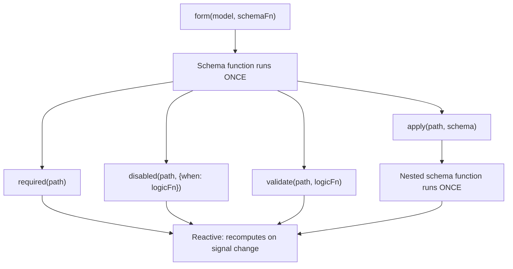

<!-- ia-translate: true -->
# Schemas e composabilidade de schemas {#schemas-and-schema-composability}

Signal Forms usa uma arquitetura de duas camadas para separar _como o seu formulário é estruturado_ de _como ele se comporta em tempo de execução_.

Quando você passa uma função de schema para `form()`, essa função _roda uma vez_ durante a criação do formulário. Seu trabalho é montar a árvore de lógica do formulário, declarando quais fields têm validação, quais fields estão desabilitados e quais fields dependem de outros fields. Esta é a **camada estrutural** do seu formulário.

Dentro de uma função de schema, você chama funções de regra como `disabled()` e `validate()`. Essas funções de regra aceitam lógica reativa que é recalculada sempre que os signals que elas referenciam mudam. Regras condicionais como `disabled()` e `required()` aceitam configuração opcional, incluindo uma função `when` que ativa a regra. Juntas, elas formam a **camada comportamental** do seu formulário em tempo de execução.

```ts
contactForm = form(this.contactModel, (schemaPath) => {
  // Função de schema: roda UMA VEZ durante a criação do formulário
  required(schemaPath.name);
  disabled(schemaPath.couponCode, {when: ({valueOf}) => valueOf(schemaPath.total) < 50});
  //  ^^^ Lógica reativa: é recalculada quando total muda
});
```



Essa distinção é importante ao compor schemas, porque funções como `apply()`, `applyWhen()` e `schema()` operam todas na camada estrutural. Os schemas controlam _quais_ regras existem e _se_ elas estão ativas, enquanto as funções de regra definem _o que_ essas regras avaliam.

## Criando schemas reutilizáveis com `schema()` {#create-reusable-schemas-with-schema}

Quando vários formulários compartilham as mesmas regras para um formato de dados comum, você pode usar a função `schema()` para extrair essas regras em um schema reutilizável.

```ts
import {schema, required, minLength} from '@angular/forms/signals';

const nameSchema = schema<{first: string; last: string}>((name) => {
  required(name.first);
  required(name.last);
  minLength(name.first, 2);
  minLength(name.last, 2);
});
```

A função `schema()` envolve uma função e a converte em um objeto `Schema<T>` reutilizável. Como qualquer função de schema, ela _roda uma vez_ por formulário, mas o próprio objeto pode ser compartilhado entre quantos formulários você precisar.

TIP: Se as regras aparecem em apenas um lugar, uma função de schema inline funciona da mesma forma. Use `schema()` quando quiser reutilizar o mesmo schema em vários formulários ou aplicar o mesmo schema a vários paths. Objetos `Schema` reutilizáveis são armazenados em cache por compilação de formulário.

### Usando o schema com `apply()` {#using-the-schema-with-apply}

Você pode aplicar um schema reutilizável a um path específico de um formulário usando a função `apply()`. Quando você chama `apply()`, o schema recebe um path com escopo, que enxerga apenas os fields dentro desse sub-path:

```ts
import {apply, form} from '@angular/forms/signals';

profileForm = form(this.profileModel, (schemaPath) => {
  apply(schemaPath.name, nameSchema);
});

registrationForm = form(this.registrationModel, (schemaPath) => {
  apply(schemaPath.name, nameSchema);
});
```

## Schemas condicionais com `applyWhen()` {#conditional-schemas-with-applywhen}

NOTE: O [guia Adicionando lógica a formulários](guide/forms/signals/form-logic) apresentou `applyWhen()` para regras condicionais com lógica inline. Esta seção aborda como compor `applyWhen()` com schemas reutilizáveis.

Algumas regras devem se aplicar apenas sob certas condições. Por exemplo, um campo de CEP pode exigir validação somente quando o país selecionado for os Estados Unidos.

A função `applyWhen()` aplica um schema condicionalmente, com base em state reativo. Ela aceita três argumentos:

1. Um path ao qual o schema será aplicado
1. Uma função de lógica reativa que retorna `true` quando o schema deve estar ativo
1. Um schema ou uma função de schema contendo as regras condicionais

```ts
import {form, applyWhen, required, pattern} from '@angular/forms/signals';

addressForm = form(this.addressModel, (schemaPath) => {
  applyWhen(
    schemaPath,
    ({valueOf}) => valueOf(schemaPath.country) === 'US',
    (schemaPath) => {
      required(schemaPath.zipCode);
      pattern(schemaPath.zipCode, /^\d{5}(-\d{4})?$/);
    },
  );
});
```

A função de lógica recebe um `FieldContext`, que fornece acesso a `value`, `valueOf`, `stateOf` e outros auxiliares reativos. Como ela é reativa, a condição é reavaliada sempre que os signals que ela lê mudam. Quando a condição passa a ser `false`, as regras dentro do schema são desativadas. Quando ela volta a ser `true`, elas são reativadas.

O schema em si continua sendo estrutural: a função de schema roda uma vez durante a criação do formulário. A condição controla se essas regras estão _ativas_, não se elas _existem_.

Dentro do schema condicional, use o parâmetro de path com escopo passado para essa função de schema. Paths de um schema externo não são válidos dentro de um schema aninhado.

### Combinando `applyWhen()` com schemas reutilizáveis {#combining-applywhen-with-reusable-schemas}

Como `applyWhen()` aceita um objeto `Schema`, você pode combiná-lo com `schema()` para aplicar schemas reutilizáveis de forma condicional:

```ts
const usZipCodeSchema = schema<{zipCode: string}>((address) => {
  required(address.zipCode);
  pattern(address.zipCode, /^\d{5}(-\d{4})?$/);
});

const caPostalCodeSchema = schema<{postalCode: string}>((address) => {
  required(address.postalCode);
  pattern(address.postalCode, /^[A-Z]\d[A-Z] \d[A-Z]\d$/);
});

shippingForm = form(this.shippingModel, (schemaPath) => {
  applyWhen(
    schemaPath.address,
    ({valueOf}) => valueOf(schemaPath.country) === 'US',
    usZipCodeSchema,
  );
  applyWhen(
    schemaPath.address,
    ({valueOf}) => valueOf(schemaPath.country) === 'CA',
    caPostalCodeSchema,
  );
});
```

NOTE: A função de lógica acessa `valueOf(schemaPath.country)` mesmo que o argumento de path seja `schemaPath.address`. Isso acontece porque o auxiliar `valueOf` pode acessar qualquer field do formulário, não apenas os fields dentro do path com escopo.

Esse padrão mantém a lógica de validação modular: as regras de endereço de cada país ficam em seu próprio schema, e o formulário seleciona qual delas ativar com base na escolha do usuário.

## Estreitamento de tipos com `applyWhenValue()` {#type-narrowing-with-applywhenvalue}

A função `applyWhenValue()` simplifica condições que precisam verificar apenas o valor do field. Em vez de receber um `FieldContext`, a função de condição recebe diretamente o valor bruto do field.

```ts {header: "applyWhen — logic function receives FieldContext"}
applyWhen(schemaPath.payment, ({value}) => value().type === 'credit-card', creditCardSchema);
```

```ts {header: "applyWhenValue — condition receives the value directly"}
applyWhenValue(schemaPath.payment, (payment) => payment.type === 'credit-card', creditCardSchema);
```

A principal vantagem de `applyWhenValue()` é o suporte a type guards do TypeScript. Quando a função de condição é um type guard, o parâmetro de tipo do schema é estreitado para o tipo protegido. Isso é especialmente útil para union types discriminados, em que cada variante tem fields diferentes que precisam de regras diferentes.

```ts
import {form, applyWhenValue, required} from '@angular/forms/signals';

interface CreditCard {
  type: 'credit-card';
  cardNumber: string;
  expiry: string;
  cvv: string;
}

interface BankTransfer {
  type: 'bank-transfer';
  accountNumber: string;
  routingNumber: string;
}

type PaymentMethod = CreditCard | BankTransfer;

function isCreditCard(value: PaymentMethod): value is CreditCard {
  return value.type === 'credit-card';
}

function isBankTransfer(value: PaymentMethod): value is BankTransfer {
  return value.type === 'bank-transfer';
}

paymentForm = form(this.paymentModel, (schemaPath) => {
  applyWhenValue(schemaPath, isCreditCard, (payment) => {
    // O TypeScript sabe que payment está restrito a CreditCard
    required(payment.cardNumber);
    required(payment.expiry);
    required(payment.cvv);
  });

  applyWhenValue(schemaPath, isBankTransfer, (payment) => {
    // O TypeScript sabe que payment está restrito a BankTransfer
    required(payment.accountNumber);
    required(payment.routingNumber);
  });
});
```

Sem o type guard, o TypeScript não saberia quais fields estão disponíveis dentro de cada função de schema. O estreitamento de tipos garante que acessar `payment.cardNumber` seja type-safe no ramo de cartão de crédito, e que acessar `payment.accountNumber` seja type-safe no ramo de transferência bancária.

## Itens de array com `applyEach()` {#array-items-with-applyeach}

Quando um formulário contém um array de objetos, você normalmente precisa aplicar as mesmas regras a cada item. A função `applyEach()` aplica um schema a cada item de um field de array, independentemente de quantos itens existam.

```ts
import {form, applyEach, required, min} from '@angular/forms/signals';

type LineItem = {name: string; quantity: number};

orderForm = form(this.orderModel, (schemaPath) => {
  required(schemaPath.title);

  applyEach(schemaPath.items, (item) => {
    required(item.name);
    min(item.quantity, 1);
  });
});
```

A função de schema passada para `applyEach()` recebe um `SchemaPathTree` com escopo para um único item do array. As regras declaradas dentro dela se aplicam a todos os itens do array, inclusive aos itens adicionados após a criação do formulário.

### Combinando `applyEach()` com schemas reutilizáveis {#combining-applyeach-with-reusable-schemas}

Como `applyEach()` aceita um objeto `Schema`, você pode extrair as regras de nível de item para um schema reutilizável e compartilhá-lo entre formulários:

```ts
const lineItemSchema = schema<LineItem>((item) => {
  required(item.name);
  min(item.quantity, 1);
});

orderForm = form(this.orderModel, (schemaPath) => {
  required(schemaPath.title);
  applyEach(schemaPath.items, lineItemSchema);
});

invoiceForm = form(this.invoiceModel, (schemaPath) => {
  required(schemaPath.invoiceNumber);
  applyEach(schemaPath.lineItems, lineItemSchema);
});
```

TIP: Para mais detalhes sobre a validação de itens de array, incluindo mensagens de erro personalizadas por field, veja o [guia de Validação](guide/forms/signals/validation).

## Próximos passos {#next-steps}

Para saber mais sobre Signal Forms, confira estes guias relacionados:

- [Adicionando lógica a formulários](guide/forms/signals/form-logic) - Aprenda a adicionar lógica condicional, comportamento dinâmico e metadados aos seus formulários
- [Validação](guide/forms/signals/validation) - Conheça as regras de validação e o tratamento de erros
- [Operações assíncronas](guide/forms/signals/async-operations) - Aprenda a tratar envio de formulários e validação assíncrona
