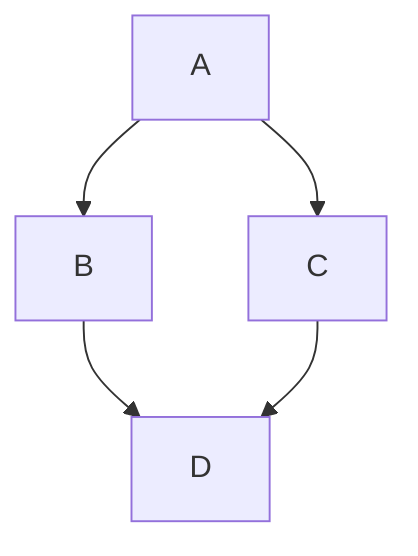
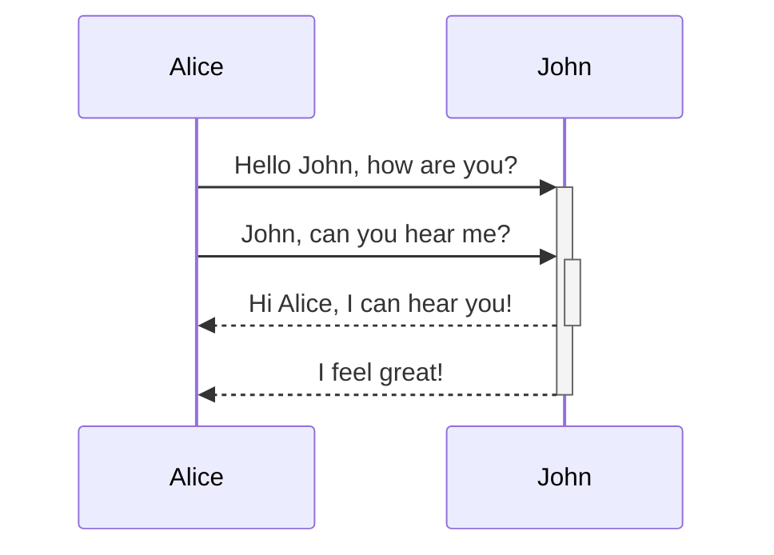
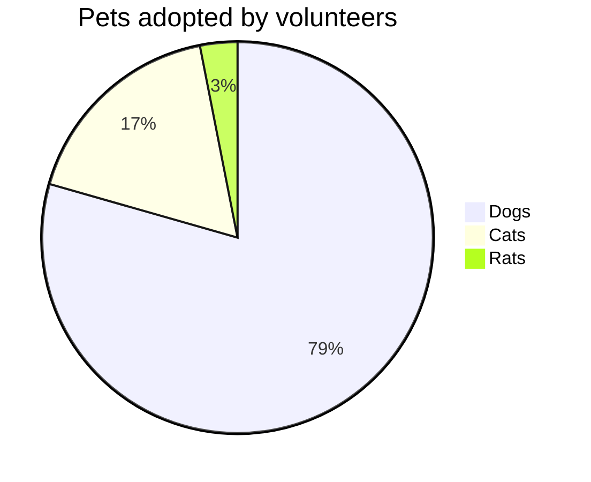

<!-- ia-translate: true -->
<docs-decorative-header title="Kitchen sink" imgSrc="adev/src/assets/images/components.svg"> <!-- markdownlint-disable-line -->
Esta é uma lista visual de todos os components customizados e estilos para o Angular.dev.
</docs-decorative-header>

Como um sistema de design, esta página contém orientações visuais e de escrita em Markdown para:

- Elementos customizados da documentação Angular: [`docs-card`](#cards), [`docs-callout`](#callouts), [`docs-pill`](#pills) e [`docs-steps`](#workflow)
- Elementos de texto customizados: [alertas](#alerts)
- Exemplos de código: [`docs-code`](#code)
- Elementos Markdown estilizados nativamente: links, listas, [cabeçalhos](#headers-h2), [linhas horizontais](#horizontal-line-divider)
- e mais!

Prepare-se para:

1. Escrever...
2. ótimas...
3. documentações!

## Cabeçalhos (h2) {#headers-h2}

### Cabeçalhos menores (h3) {#smaller-headers-h3}

#### Ainda menor (h4) {#even-smaller-h4}

##### Ainda mais menor (h5) {#even-more-smaller-h5}

###### O menor de todos! (h6) {#the-smallest-h6}

## Cards

<docs-card-container>
  <docs-card title="O que é o Angular?" link="Visão geral da plataforma" href="tutorials/first-app">
    Lorem ipsum dolor sit amet, consectetur adipiscing elit. Nullam ornare ligula nisi
  </docs-card>
  <docs-card title="Segundo card" link="Experimente agora" href="essentials/what-is-angular">
    Lorem ipsum dolor sit amet, consectetur adipiscing elit. Nullam ornare ligula nisi
  </docs-card>
    <docs-card title="Card sem link">
    Lorem ipsum dolor sit amet, consectetur adipiscing elit. Nullam ornare ligula nisi
  </docs-card>
</docs-card-container>

### Atributos de `<docs-card>` {#docs-card-attributes}

| Atributos               | Detalhes                                                    |
| :---------------------- | :---------------------------------------------------------- |
| `<docs-card-container>` | Todos os cards devem estar aninhados dentro de um container |
| `title`                 | Título do card                                              |
| conteúdo do corpo       | Qualquer coisa entre `<docs-card>` e `</docs-card>`         |
| `link`                  | (Opcional) Texto do link de Call to Action                  |
| `href`                  | (Opcional) Href do link de Call to Action                   |

## Callouts

<docs-callout title="Título de um callout útil">
  Lorem ipsum dolor sit amet, consectetur adipiscing elit. Nulla luctus metus blandit semper faucibus. Sed blandit diam quis tellus maximus, ac scelerisque ex egestas. Ut euismod lobortis mauris pretium iaculis. Quisque ullamcorper, elit ut lacinia blandit, magna sem finibus urna, vel suscipit tortor dolor id risus.
</docs-callout>

<docs-callout critical title="Título de um callout crítico">
  Lorem ipsum dolor sit amet, consectetur adipiscing elit. Nulla luctus metus blandit semper faucibus. Sed blandit diam quis tellus maximus, ac scelerisque ex egestas. Ut euismod lobortis mauris pretium iaculis. Quisque ullamcorper, elit ut lacinia blandit, magna sem finibus urna, vel suscipit tortor dolor id risus.
</docs-callout>

<docs-callout important title="Título de um callout importante">
  Lorem ipsum dolor sit amet, consectetur adipiscing elit. Nulla luctus metus blandit semper faucibus. Sed blandit diam quis tellus maximus, ac scelerisque ex egestas. Ut euismod lobortis mauris pretium iaculis. Quisque ullamcorper, elit ut lacinia blandit, magna sem finibus urna, vel suscipit tortor dolor id risus.
</docs-callout>

### Atributos de `<docs-callout>` {#docs-callout-attributes}

| Atributos                                       | Detalhes                                                             |
| :---------------------------------------------- | :------------------------------------------------------------------- |
| `title`                                         | Título do callout                                                    |
| conteúdo do corpo                               | Qualquer coisa entre `<docs-callout>` e `</docs-callout>`            |
| `helpful` (padrão) \| `critical` \| `important` | (Opcional) Adiciona estilos e ícones baseados no nível de severidade |

## Pills

Linhas de pills são úteis como uma espécie de navegação, com links para recursos úteis.

<docs-pill-row id=pill-row>
  <docs-pill href="#pill-row" title="Link"/>
  <docs-pill href="#pill-row" title="Link"/>
  <docs-pill href="#pill-row" title="Link"/>
  <docs-pill href="#pill-row" title="Link"/>
  <docs-pill href="#pill-row" title="Link"/>
  <docs-pill href="#pill-row" title="Link"/>
</docs-pill-row>

### Atributos de `<docs-pill>` {#docs-pill-attributes}

| Atributos        | Detalhes                                                    |
| :--------------- | :---------------------------------------------------------- |
| `<docs-pill-row` | Todas as pills devem estar aninhadas dentro de uma pill row |
| `title`          | Texto da pill                                               |
| `href`           | Href da pill                                                |

Pills também podem ser usadas sozinhas, em linha, mas ainda não construímos isso.

## Alertas {#alerts}

Alertas são apenas parágrafos especiais. Eles são úteis para chamar atenção (não confundir com call-out) para algo um pouco mais urgente. Eles herdam o tamanho da fonte do contexto e estão disponíveis em vários níveis. Tente não usar alertas para renderizar muito conteúdo, e sim para realçar e chamar atenção para o conteúdo ao redor.

Estilize alertas começando em uma nova linha no Markdown, usando o formato `SEVERITY_LEVEL` + `:` + `ALERT_TEXT`.

NOTE: Use Note para informações auxiliares ou adicionais que não são _essenciais_ para o texto principal.

TIP: Use Tip para destacar uma tarefa ou ação específica que os usuários podem realizar, ou um fato que se relaciona diretamente com uma tarefa ou ação.

TODO: Use TODO para documentação incompleta que você planeja expandir em breve. Você também pode atribuir o TODO, por exemplo, TODO(emmatwersky): Text.

QUESTION: Use Question para fazer uma pergunta ao leitor, como um mini-quiz que ele deve ser capaz de responder.

SUMMARY: Use Summary para fornecer uma sinopse de duas ou três frases do conteúdo da página ou seção, para que os leitores possam descobrir se este é o lugar certo para eles.

TLDR: Use TL;DR (ou TLDR) se você puder fornecer a informação essencial sobre uma página ou seção em uma ou duas frases. Por exemplo, TLDR: Rhubarb é um gato.

CRITICAL: Use Critical para destacar coisas potencialmente ruins ou alertar o leitor de que ele deve ter cuidado antes de fazer algo. Por exemplo, Aviso: executar `rm` com a opção `-f` vai apagar arquivos ou diretórios protegidos contra escrita sem perguntar.

IMPORTANT: Use Important para informações cruciais para compreender o texto ou para concluir alguma tarefa.

HELPFUL: Use Best practice para destacar práticas que são comprovadamente bem-sucedidas ou melhores do que as alternativas.

NOTE: Atenção, `desenvolvedores`! Alertas _podem_ ter um [link](#alerts) e outros estilos aninhados (mas use isso com moderação)!.

## Código {#code}

Você pode exibir `código` usando o triplo crase embutido:

```ts
example code
```

Ou usando o elemento `<docs-code>`.

<docs-code header="Seu primeiro exemplo" language="ts" linenums>
import { Component } from '@angular/core';

@Component({
selector: 'example-code',
template: '<h1>Hello World!</h1>',
})
export class ComponentOverviewComponent {}
</docs-code>

### Estilizando o exemplo {#styling-the-example}

Aqui está um exemplo de código totalmente estilizado:

<docs-code
  path="adev/src/content/examples/hello-world/src/app/app.component-old.ts"
  header="Um exemplo de código estilizado"
  language='ts'
  linenums
  highlight="[[3,7], 9]"
  preview
  visibleLines="[3,10]">
</docs-code>

Também temos estilização para o terminal, basta definir a linguagem como `shell`:

```shell
npm install @angular/material --save
```

Você pode estilizar blocos de triplo crase padrão do Markdown com atributos para uma apresentação aprimorada:

```ts {header:"Título incrível", linenums, highlight: [2], hideCopy}
console.log('Hello, World!');
console.log('Awesome Angular Docs!');
```

#### Atributos de `<docs-code>` {#docs-code-attributes}

| Atributos      | Tipo                 | Detalhes                                                        |
| :------------- | :------------------- | :-------------------------------------------------------------- |
| code           | `string`             | Qualquer coisa entre as tags é tratada como código              |
| `path`         | `string`             | Caminho para o exemplo de código (raiz: `content/examples/`)    |
| `header`       | `string`             | Título do exemplo (padrão: `file-name`)                         |
| `language`     | `string`             | linguagem do código                                             |
| `linenums`     | `boolean`            | (False) exibe os números das linhas                             |
| `highlight`    | `string of number[]` | linhas destacadas                                               |
| `visibleLines` | `string of number[]` | intervalo de linhas para o modo recolhido                       |
| `region`       | `string`             | exibe apenas a região fornecida.                                |
| `preview`      | `boolean`            | (False) exibe o preview                                         |
| `hideCode`     | `boolean`            | (False) Se o exemplo de código deve ser recolhido por padrão.   |
| `hideDollar`   | `boolean`            | (False) Se o cifrão deve ser ocultado em exemplos de código shell. |

### Exemplos de múltiplos arquivos {#multifile-examples}

Você pode criar exemplos com múltiplos arquivos envolvendo os exemplos dentro de um `<docs-code-multifile>`.

<docs-code-multifile
  path="adev/src/content/examples/hello-world/src/app/app.component.ts"
  preview>
<docs-code
    path="adev/src/content/examples/hello-world/src/app/app.component.html"
    highlight="[1]"
    linenums/>
<docs-code
    path="adev/src/content/examples/hello-world/src/app/app.component.css" />
</docs-code-multifile>

#### Atributos de `<docs-code-multifile>` {#docs-code-multifile-attributes}

| Atributos         | Tipo      | Detalhes                                                       |
| :---------------- | :-------- | :------------------------------------------------------------- |
| conteúdo do corpo | `string`  | abas aninhadas de exemplos `docs-code`                         |
| `path`            | `string`  | Caminho para o exemplo de código para o preview e o link externo |
| `preview`         | `boolean` | (False) exibe o preview                                        |
| `hideCode`        | `boolean` | (False) Se o exemplo de código deve ser recolhido por padrão.  |

### Adicionando `preview` ao seu exemplo de código {#adding-preview-to-your-code-example}

Adicionar a flag `preview` cria um exemplo em execução do código abaixo do trecho de código. Isso também adiciona automaticamente um botão para abrir o exemplo em execução no StackBlitz.

NOTE: `preview` funciona apenas com standalone.

### Estilizando previews de exemplos com Tailwind CSS {#styling-example-previews-with-tailwind-css}

Classes utilitárias do Tailwind podem ser usadas dentro de exemplos de código.

<docs-code-multifile
  path="adev/src/content/examples/hello-world/src/app/tailwind-app.component.ts"
  preview>
<docs-code path="adev/src/content/examples/hello-world/src/app/tailwind-app.component.html" />
<docs-code path="adev/src/content/examples/hello-world/src/app/tailwind-app.component.ts" />
</docs-code-multifile>

## Abas {#tabs}

<docs-tab-group>
  <docs-tab label="Exemplo de código">
    <docs-code-multifile
      path="adev/src/content/examples/hello-world/src/app/tailwind-app.component.ts"
      hideCode="true"
      preview>
    <docs-code path="adev/src/content/examples/hello-world/src/app/tailwind-app.component.html" />
    <docs-code path="adev/src/content/examples/hello-world/src/app/tailwind-app.component.ts" />
    </docs-code-multifile>
  </docs-tab>
  <docs-tab label="Algum texto">
    Lorem ipsum dolor sit amet, consectetur adipiscing elit. Nulla luctus metus blandit semper faucibus. Sed blandit diam quis tellus maximus, ac scelerisque ex egestas. Ut euismod lobortis mauris pretium iaculis. Quisque ullamcorper, elit ut lacinia blandit, magna sem finibus urna, vel suscipit tortor dolor id risus.
  </docs-tab>
</docs-tab-group>

## Fluxo de trabalho {#workflow}

Estilize passos numerados usando `<docs-step>`. A numeração é criada com CSS (prático!).

### Atributos de `<docs-workflow>` e `<docs-step>` {#docs-workflow-and-docs-step-attributes}

| Atributos         | Detalhes                                                    |
| :---------------- | :---------------------------------------------------------- |
| `<docs-workflow>` | Todos os passos devem estar aninhados dentro de um workflow |
| `title`           | Título do passo                                             |
| conteúdo do corpo | Qualquer coisa entre `<docs-step>` e `</docs-step>`         |

Os passos devem começar em uma nova linha e podem conter `docs-code`s e outros elementos e estilos aninhados.

<docs-workflow>

<docs-step title="Instale o Angular CLI {#install-the-angular-cli}">
  Você usa o Angular CLI para criar projetos, gerar código de aplicações e bibliotecas e realizar uma variedade de tarefas contínuas de desenvolvimento, como testes, bundling e deployment.

Para instalar o Angular CLI, abra uma janela de terminal e execute o seguinte comando:

```shell
npm install -g @angular/cli
```

</docs-step>

<docs-step title="Crie um workspace e uma aplicação inicial {#create-a-workspace-and-initial-application}">
  Você desenvolve aplicações no contexto de um workspace Angular.

Para criar um novo workspace e uma aplicação inicial de exemplo:

- Execute o comando do CLI `ng new` e forneça o nome `my-app`, como mostrado aqui:

  ```shell
  ng new my-app
  ```

- O comando `ng new` pergunta sobre os recursos a incluir na aplicação inicial. Aceite os padrões pressionando a tecla Enter ou Return.

  O Angular CLI instala os pacotes npm do Angular necessários e outras dependências. Isso pode levar alguns minutos.

  O CLI cria um novo workspace e uma aplicação Welcome simples, pronta para ser executada.
  </docs-step>

<docs-step title="Execute a aplicação {#run-the-application}">
  O Angular CLI inclui um servidor para você construir e servir a sua aplicação localmente.

1. Navegue até a pasta do workspace, como `my-app`.
2. Execute o seguinte comando:

   ```shell
   cd my-app
   ng serve --open
   ```

O comando `ng serve` inicia o servidor, observa os seus arquivos e reconstrói a aplicação conforme você faz alterações nesses arquivos.

A opção `--open` (ou apenas `-o`) abre automaticamente o seu navegador em <http://localhost:4200/>.
Se a sua instalação e configuração tiverem sido bem-sucedidas, você deverá ver uma página semelhante à seguinte.
</docs-step>

<docs-step title="Passo final {#final-step}">
  São esses todos os components de documentação! Agora:

  <docs-pill-row>
    <docs-pill href="#pill-row" title="Vá"/>
    <docs-pill href="#pill-row" title="escreva"/>
    <docs-pill href="#pill-row" title="ótima"/>
    <docs-pill href="#pill-row" title="documentação!"/>
  </docs-pill-row>
</docs-step>

</docs-workflow>

## Imagens e vídeo {#images-and-video}

Você pode adicionar imagens usando a imagem semântica do Markdown:


### Adicione `#small` e `#medium` para mudar o tamanho da imagem {#add-small-and-medium-to-change-the-image-size}


## Adicione atributos usando a sintaxe de chaves {#add-attributes-using-curly-braces-syntax}


Vídeos incorporados são criados com `docs-video` e precisam apenas de um `src` e de um `title`:

<docs-video src="https://www.youtube.com/embed/O47uUnJjbJc" title="Expressão alterada após a verificação"/>

## Gráficos e diagramas {#charts--graphs}

Escreva diagramas e gráficos usando o [Mermaid](https://mermaid.js.org/) definindo a linguagem do código como `mermaid`; toda a tematização já está incorporada.







## Divisor de linha horizontal {#horizontal-line-divider}

Isso pode ser usado para separar seções da página, como estamos prestes a fazer abaixo. Esses estilos são adicionados por padrão, sem necessidade de nada personalizado.

<hr/>

O fim!

## Preferir / Evitar {#prefer---avoid}

```ts {prefer}
const foo = 'bar';
```

```ts {avoid}
const bar = 'foo';
```

```ts {avoid, header: 'com um cabeçalho'}
const baz = 42;
```

<docs-code
  path="adev/src/content/examples/hello-world/src/app/app.component-old.ts"
  header="Um exemplo de código estilizado"
  language='ts'
  linenums
  highlight="[[3,7], 9]"
  prefer>
</docs-code>
